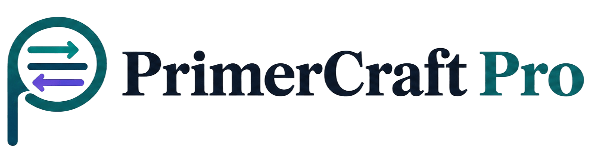

<div align="center">



# PrimerCraft Pro

**Diseño y puntuación automática de primers para PCR/qPCR**

**Trabajo Final — Ingeniería de Software (2026)**

**[Ver la documentación publicada](https://matiasriosmr.github.io/PrimerCraft-Pro-2026/)**

</div>

---

## Integrantes

- Barbara Sara
- Vergara Emilia
- Rios Matias

**Carrera:** Licenciatura en Bioinformática

**Institución:** Facultad de Ingeniería, Universidad Nacional de Entre Ríos (FIUNER)

---
## Sobre el proyecto

**PrimerCraft Pro** es una herramienta que diseña y puntúa automáticamente pares de primers para PCR/qPCR a partir de una secuencia blanco, garantizando la trazabilidad e integrando en un solo flujo:

- **Cálculo termodinámico** (Tm, %GC)
- **Detección de estructuras secundarias** (hairpins, dímeros) y **variantes**
- **Simulación del amplicón**
- **Verificación de especificidad**

Está pensada para investigadores/as de biología molecular que hoy alternan entre múltiples herramientas dispersas (NCBI, Primer3/Primer-BLAST, verificadores de estructura) para llegar al mismo resultado.

Para profundizar más sobre esto, ir a: [`docs/requirements/srs.md`](docs/requirements/srs.md)


---

## Arquitectura en breve

La arquitectura se deriva de un problema: NCBI BLAST limita las consultas (100 corridas cada 24 h) y puede rechazar pedidos durante horas, y el sistema no puede perder los candidatos ya calculados (escenario de calidad `EC-05`, driver principal).

- **Estilo base: tuberías y filtros.** Una cadena de etapas independientes (Preparación de datos, Diseño de candidatos y Verificación de especificidad) conectadas por tuberías de mensajes que guardan el trabajo en disco, de modo que la espera de BLAST no frena al resto.
- **Interfaz: cliente-servidor.** Una aplicación web que conversa con una API, que es la única que accede a la base de datos.
- **Patrones por contenedor:** broker en las tuberías, hexagonal en las etapas con servicios externos (`EC-03`, `EC-04`), capas en la API y MVVM en la web.
- **Despliegue:** una sola VPS con Docker, con reinicio automático de los contenedores, volúmenes en disco y backup de la base fuera de la VPS.
- **Tecnologías propuestas:** TypeScript y React (web), Node.js y Fastify (API), Python (etapas de cálculo), NATS JetStream (tuberías) y PostgreSQL (base de datos).

El detalle está en [`docs/architecture/arquitectura.md`](docs/architecture/arquitectura.md).

---

## Modelo de ciclo de vida

Se elige el ciclo de vida **Iterativo e Incremental** porque permite construir la herramienta por etapas, entregando primero el núcleo útil del sistema y agregando valor funcional en cada entrega. De forma **incremental**, se puede poner a punto el cálculo básico de primers antes de sumar capacidades más avanzadas como la alerta por variantes poblacionales (SNPs) o el procesamiento automático de listas en lote. De forma **iterativa**, permite ajustar progresivamente aspectos complejos como la conexión con servicios externos (NCBI BLAST), probando primero con una versión simulada antes de implementar la integración definitiva.


---

## Documentación

| Área | Documento | Contenido |
|---|---|---|
| Requerimientos | [`docs/requirements/srs.md`](docs/requirements/srs.md) | SRS: visión y alcance, requerimientos funcionales y no funcionales, casos de uso e historias de usuario |
| | [`docs/requirements/quality-scenarios/quality-scenarios.md`](docs/requirements/quality-scenarios/quality-scenarios.md) | Escenarios de calidad (ISO/IEC 25010) |
| | [`docs/requirements/quality-scenarios/registro-uso-ia.md`](docs/requirements/quality-scenarios/registro-uso-ia.md) | Registro de uso de IA de los escenarios de calidad |
| Arquitectura | [`docs/architecture/contexto_inicial.md`](docs/architecture/contexto_inicial.md) | Diagrama de contexto (DFD nivel 0 y nivel 1) |
| | [`docs/architecture/modelo-dominio-inicial.md`](docs/architecture/modelo-dominio-inicial.md) | Modelo de dominio |
| | [`docs/architecture/arquitectura.md`](docs/architecture/arquitectura.md) | Documento de especificación de arquitectura: drivers, estrategia de solución (tácticas, estilos y patrones), vistas C4 de contenedores, componentes y despliegue, historias de usuario sobre las vistas, decisiones `DA-xx`, trazabilidad y riesgos |
| UX | [`docs/ui/README.md`](docs/ui/README.md) | Índice del diseño de experiencia de usuario |
| | [`docs/ui/user-profiles/perfil-investigador.md`](docs/ui/user-profiles/perfil-investigador.md) | Perfil de usuario, escenarios de uso y flujos de navegación |
| | [`docs/ui/criterios_generacion.md`](docs/ui/criterios_generacion.md) | Criterios de generación de las maquetas |
| | [`docs/ui/heuristic-review/`](docs/ui/README.md#pantallas) | Evaluación heurística de cada pantalla (UI-1 a UI-5) |
| Maquetas | `docs/ui/mockups/` | Maquetas HTML de las 5 pantallas y sus capturas de escritorio y móvil. Para usarlas en el navegador: [UI-1](https://matiasriosmr.github.io/PrimerCraft-Pro-2026/ui/mockups/hu-01-1_nueva-corrida-diseno.html), [UI-2](https://matiasriosmr.github.io/PrimerCraft-Pro-2026/ui/mockups/hu-04_hu-02-1_progreso-corrida.html), [UI-3](https://matiasriosmr.github.io/PrimerCraft-Pro-2026/ui/mockups/hu-05_resultados-candidatos.html), [UI-4](https://matiasriosmr.github.io/PrimerCraft-Pro-2026/ui/mockups/hu-03-1_validar-primer.html), [UI-5](https://matiasriosmr.github.io/PrimerCraft-Pro-2026/ui/mockups/hu-03-3_resultado-validacion.html) |
| Marca | `docs/marca/` | Isotipo y logotipo del grupo |
| Uso de IA | [`uso_de_ia/uso_de_ia.md`](uso_de_ia/uso_de_ia.md) | Registro general de uso de IA generativa, actualizado TP a TP |

## Estructura del repositorio

```
PrimerCraft-Pro-2026/
├── README.md
├── docs/                         # documentación; se publica como sitio web (GitHub Pages)
│   ├── index.md                  # portada del sitio
│   ├── _config.yml               # configuración del sitio (tema, menú, Mermaid)
│   ├── _includes/, _sass/        # personalización del tema (estilos, scripts, diagramas)
│   ├── requirements/             # TP1 y TP2: requerimientos y calidad
│   │   ├── srs.md                # SRS
│   │   └── quality-scenarios/    # escenarios de calidad y su registro de uso de IA
│   ├── architecture/             # TP1 y TP3: modelos y arquitectura
│   │   ├── contexto_inicial.md          # diagrama de contexto (DFD nivel 0 y 1)
│   │   ├── modelo-dominio-inicial.md    # modelo de dominio
│   │   └── arquitectura.md              # especificación de arquitectura (vistas C4, decisiones)
│   ├── ui/                       # TP2: experiencia de usuario
│   │   ├── user-profiles/        # perfil de usuario, escenarios y flujos
│   │   ├── mockups/              # maquetas HTML y capturas (capturas/, capturas/movil/)
│   │   └── heuristic-review/     # evaluación heurística por pantalla
│   └── marca/                    # isotipo y logotipo
├── src/                          # código fuente (todavía vacío)
├── tests/                        # pruebas (todavía vacío)
└── uso_de_ia/                    # registro general de uso de IA, actualizado TP a TP
```

---

## Licencia

Proyecto académico desarrollado en el marco de la materia **Ingeniería de Software** (FIUNER, 2026). Uso educativo.
