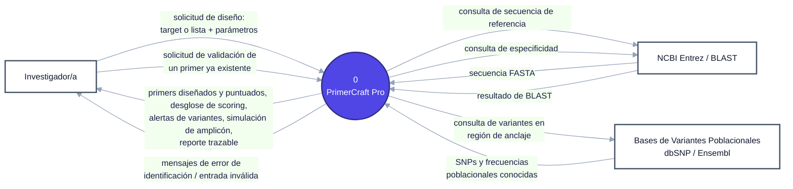
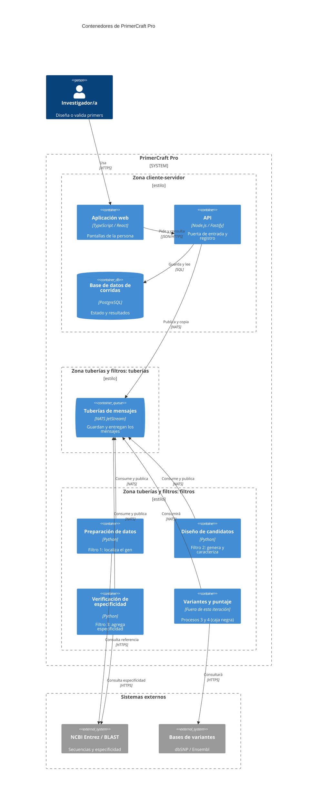
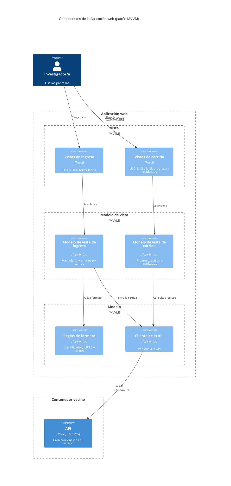
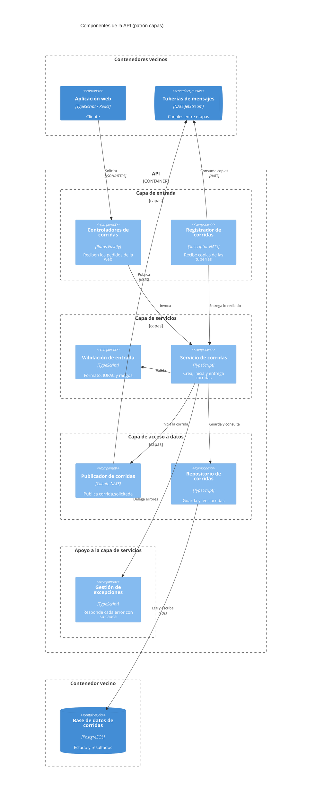
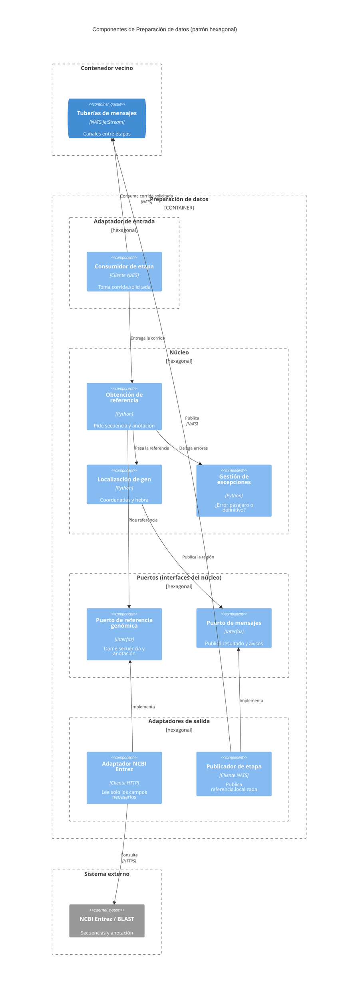
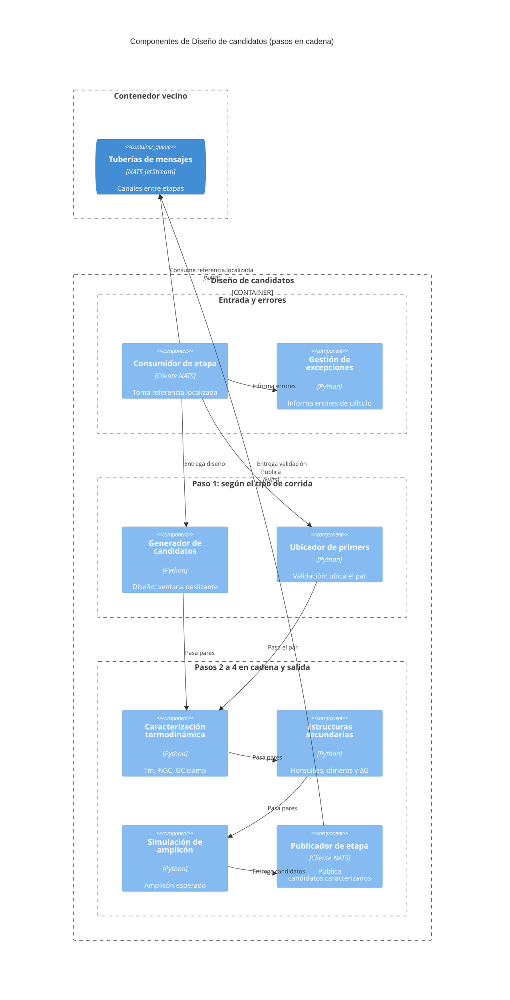
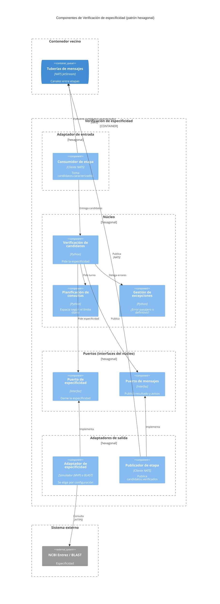
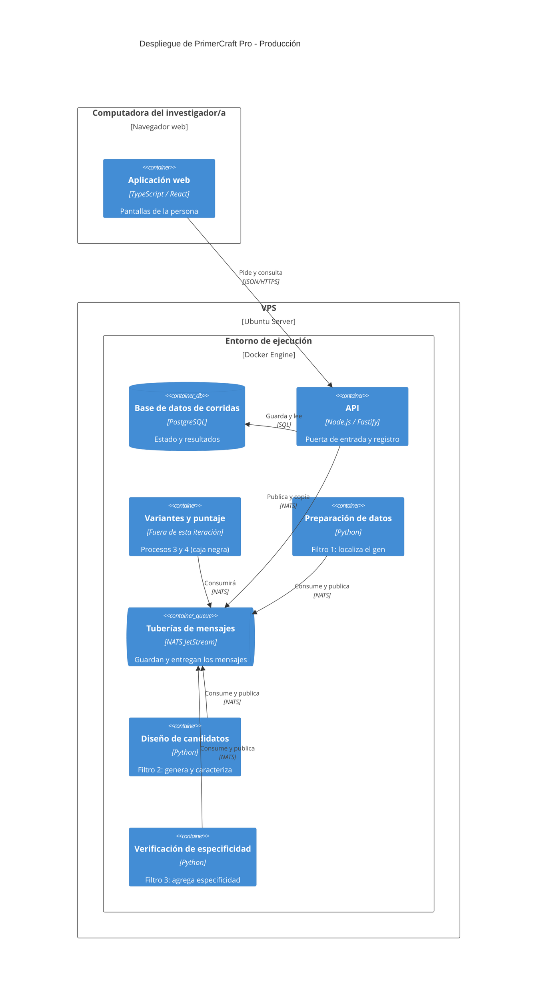

 
 
# Documento de Especificación de Arquitectura — PrimerCraft Pro
 
 
**Ingeniería de Software 2026 · FIUNER · TP3**
 
 
| | |
|---|---|
| **Proyecto** | PrimerCraft Pro |
| **Integrantes** | Sara Barbará, Emilia Vergara, Matías Ríos |
| **Versión** | 1.2 (2026-10-24) |
| **Base** | [SRS](../requirements/srs.md) (TP1) · [Escenarios de calidad](../requirements/quality-scenarios/quality-scenarios.md) (TP2) · [Diagrama de contexto](contexto_inicial.md) |
 
 
## Índice
 
 
1. [Introducción](#1-introducción)
2. [Restricciones](#2-restricciones)
3. [Contexto](#3-contexto)
4. [Drivers arquitectónicos](#4-drivers-arquitectónicos)
5. [Estrategia de solución](#5-estrategia-de-solución)
6. [Vista de contenedores](#6-vista-de-contenedores)
7. [Vista de componentes](#7-vista-de-componentes)
8. [Vista de despliegue](#8-vista-de-despliegue)
9. [Historias de usuario sobre las vistas](#9-historias-de-usuario-sobre-las-vistas)
10. [Decisiones de arquitectura](#10-decisiones-de-arquitectura)
11. [Trazabilidad y riesgos](#11-trazabilidad-y-riesgos)
12. [Glosario y bibliografía](#12-glosario-y-bibliografía)
---
 
 
## 1. Introducción
 
 
### 1.1 Propósito
 
Este documento explica cómo está armado PrimerCraft Pro por dentro, por qué lo armamos así y cómo cada decisión se conecta con los requerimientos (TP1) y los escenarios de calidad (TP2). El proyecto y el alcance no cambian.
 
**La idea que guía todo el documento.** NCBI BLAST, el servicio que usamos para verificar la especificidad de los primers, limita la cantidad de consultas y puede rechazar pedidos durante horas. Cuando eso pasa, el sistema no puede perder los candidatos que ya calculó ni pedirle a la persona que empiece de nuevo (escenario `EC-05`). Toda la arquitectura se deriva de ese problema:
 
1. **El problema** (sección 4): qué escenarios de calidad obligan a darle una forma determinada al sistema.
2. **Los mecanismos** (sección 5.1): qué hay que hacer para resolverlo (guardar el trabajo, reintentar solo, mostrar lo que ya está listo).
3. **La organización general** (sección 5.2): una cadena de etapas separadas, para que la espera de BLAST no frene al resto, y una interfaz web que conversa con el sistema.
4. **La organización de cada pieza por dentro** (sección 5.3).
5. **Cómo se cumple el escenario y qué cuesta** (sección 5.4).
### 1.2 Alcance
 
Se trabajan los dos procesos elegidos en el TP1 (SRS §4):
 
- **Proceso 1 · Preparar target y secuencia de referencia** (CU-01, CU-04).
- **Proceso 2 · Generar y caracterizar candidatos de primers** (CU-02, CU-03, CU-05).
Historias de usuario implementadas: HU-01.1, HU-02.1, HU-02.2, HU-03.1, HU-03.2, HU-03.3, HU-04 y HU-05.
 
Los procesos 3 (variantes poblacionales) y 4 (puntaje y trazabilidad) quedan como **caja negra**: aparecen como un único contenedor sin detalle interno, y la [sección 6.3](#63-cómo-se-sumarían-los-procesos-3-y-4) explica dónde se conectarían.
 
 
### 1.3 Relación con el DFD del TP1
 
El DFD dice **qué** hace y con quien interactua el sistema; la arquitectura decide **cómo se reparte ese trabajo en piezas**. No tiene por qué haber una pieza por proceso.
 
| Elemento del DFD Nivel 1 | En esta arquitectura |
|---|---|
| P1 · Gestor de preparación de datos | Contenedor "Preparación de datos". La validación de formato que el DFD incluye en P1 se hace antes, en la "Aplicación web" y la "API" |
| P2 · Gestor de diseño de candidatos | **Dos contenedores:** "Diseño de candidatos" (cálculo) y "Verificación de especificidad" (consulta a BLAST). Ver 1.4 |
| P3 y P4 | Contenedor "Variantes y puntaje", caja negra (fuera de esta iteración) |
| D1 · Corridas de diseño | Contenedor "Base de datos de corridas" |
| NCBI Entrez / BLAST | Sistema externo (no es un contenedor: no lo construimos nosotros) |
 
 
### 1.4 ¿Por qué P2 se reparte en dos contenedores?
 
En el TP2, el artefacto del escenario `EC-05` era "la verificación de especificidad del Gestor de Diseño de Candidatos (P2)". En esta arquitectura la verificación pasa a ser un contenedor propio, justamente para cumplir ese escenario:
 
1. **Si BLAST rechaza, el diseño sigue funcionando.** El cálculo de candidatos es local y rápido; la verificación de especificidad depende de un servicio externo con cuota diaria. Si estuvieran juntos, una espera de BLAST frenaría el cálculo de todas las corridas. Separados, solo espera la verificación, que agrega un dato más a cada par de primers.
2. **Mientras se espera, la persona ya ve los resultados termodinámicos.** Los candidatos con su Tm, %GC, ΔG y amplicón ya están calculados y guardados, y se muestran con la especificidad "pendiente".
3. **Un reintento repite solo la consulta a BLAST**, no todo el cálculo.
**¿Y si un candidato no es específico?** En esta iteración no hay rediseño automático: la especificidad es un dato más del candidato, que la persona revisa para elegir (postcondición de CU-05). Quien decidirá "este candidato no sirve, hay que diseñar otro" es el **Proceso 4** (SRS §4: P4 "orquesta el ciclo de reintentos"), que está fuera de esta iteración.
 
Cuando P4 exista, el recorrido será este:
 
1. El par se diseña, se caracteriza y se le agrega la especificidad, aunque sea baja. No vuelve hacia atrás.
2. Sigue la cadena hasta llegar a P4.
3. Si P4 decide que hace falta otro diseño, **abre una corrida nueva** que entra por el comienzo de la cadena con más información: las posiciones a evitar en la secuencia para lograr un par de primers más específicos.
4. Al final, la persona ve todos los pares posibles, incluidos los de baja especificidad, y elige el que quiere.
Así se respeta la regla de tuberías y filtros de no tener retornos hacia etapas anteriores (ver 5.2).
 
 
### 1.5 Contenedor y componente
 
- Un **contenedor** es algo que se ejecuta por separado (una aplicación, una base de datos, una cola de mensajes) y se comunica con otros por red.
- Un **componente** es una parte *dentro* de un contenedor: vive en el mismo programa y se comunica con los demás componentes mediante llamadas internas.
> **Tecnologías propuestas:** TypeScript y React en la web, Node.js y Fastify en la API, Python en las etapas de cálculo, NATS JetStream para las tuberías y PostgreSQL para la base de datos.
 
 
---
 
 
## 2. Restricciones
 
| Restricción | Qué implica para la arquitectura |
|---|---|
| Somos tres personas y tenemos un cuatrimestre | Pocas piezas que operar; descartamos microservicios |
| Las bibliotecas de cálculo bioinformático están en Python (Biopython, primer3-py) | Python para el cálculo; TypeScript para la web y la API (`DA-07`) |
| No hay presupuesto | Todo con software libre, en una sola máquina |
| NCBI BLAST público limita el uso a 100 corridas cada 24 h (SRS RF-06) | Las consultas se espacian y se postergan cuando se llega al límite |
| En el MVP la especificidad se simula localmente; BLAST real es una etapa posterior (SRS §2.6) | Tiene que poder pasarse de la simulación a BLAST sin rehacer el sistema |
| Datos biológicos públicos, sin datos personales (SRS §2.8) | No hay cuentas ni inicio de sesión |
| Ciclo de vida iterativo e incremental: P3 y P4 vienen después | Poder sumarlos sin modificar lo que ya funciona |
 
 
---
 
 
## 3. Contexto
 
Es el diagrama de contexto (DFD Nivel 0) del TP1, sin cambios: los mismos actores y sistemas externos. El original está en [`contexto_inicial.md`](contexto_inicial.md#nivel-0).
 

 
 
---
 
 
## 4. Drivers arquitectónicos
 
Un **driver** es un escenario de calidad que **no se puede cumplir agregando código en un solo lugar**: obliga a cambiar la forma del sistema, por ejemplo agregando un programa aparte, una cola de mensajes o una división en partes.
 
**Cómo lo decidimos.** Para cada escenario nos preguntamos: si el sistema fuera lo más simple posible (una página web, un programa servidor y una base de datos), ¿alcanzaría con agregar código en una sola parte para cumplirlo? Si la respuesta es sí, no es driver.
 
 
### 4.1 Escenarios del TP2
 
Cada escenario del TP2 tiene un identificador `EC-xx`. La columna "Atributo (libro)" aplica la Tabla 1 de la consigna, que traduce la subcaracterística de ISO/IEC 25010 al atributo del libro de Bass, Clements y Kazman, cuyas tácticas usamos en la sección 5.
 
| ID | Escenario (TP2) | Subcaracterística ISO 25010 | Atributo (libro) | Medida de respuesta | ¿Driver? |
|---|---|---|---|---|---|
| `EC-01` | NCBI no devuelve la anotación del gen | Pertinencia funcional | Sin correspondencia: es un requerimiento funcional (RF-10) | 0 herramientas externas y 0 pasos manuales | No |
| `EC-02` | Identificador o secuencia con formato inválido | Protección frente a errores del usuario | Usabilidad | 0 consultas a NCBI; 100 % de los demás campos conservados; corrección en < 10 s | No |
| `EC-03` | Incorporar un nuevo proveedor genómico | Modificabilidad | Modificabilidad | < 15 h/persona; 0 líneas modificadas en el motor de diseño; 0 regresiones | **Sí (secundario)** |
| `EC-04` | NCBI cambia el formato de su respuesta | Interoperabilidad | Interoperabilidad | 100 % de respuestas convertidas; 0 corridas interrumpidas | No |
| `EC-05` | BLAST rechaza la conexión por cuota o timeout | Tolerancia a fallos | Disponibilidad | 0 % de candidatos perdidos; 100 % reintentados sin que la persona vuelva a cargar la corrida | **Sí (principal)** |
 
 
### 4.2 ¿Por qué `EC-05` es el driver principal?
 
Imaginemos la versión más simple del sistema: una página web, un programa servidor y una base de datos. Cuando la persona aprieta "Diseñar", el servidor calcula los candidatos, consulta a BLAST y recién ahí devuelve todo junto.
 
Ahora supongamos que BLAST contesta "superaste el límite de consultas, volvé más tarde". Con esa versión:
 
- BLAST va a **rechazar pedidos muy seguido**. BLAST permite 100 consultas cada 24 horas: que rechace pedidos es parte de su funcionamiento normal, no un error raro.
- **Se pierde lo calculado.** La página no puede quedarse esperando horas: el pedido se corta y los candidatos ya calculados se pierden con él. Si los guardáramos en la memoria del servidor, también se perderían si el programa se reinicia. Esto incumple "0 % de candidatos perdidos".
- **No podemos pedirle a la persona que vuelva a empezar.** El escenario exige que el reintento sea automático.
Para cumplir el escenario hacen falta tres cosas que la versión simple no tiene:
 
1. Que el trabajo se haga **en segundo plano**, en programas aparte, y no mientras la página espera.
2. Un lugar que **guarde los candidatos** hasta que BLAST responda y que no se borre si algo se reinicia (una cola de mensajes guardada en disco).
3. Que la consulta a BLAST esté **separada del cálculo**, para que su espera no frene el diseño (ver 1.4).
Agregar programas aparte y una cola cambia la forma del sistema, no solo su código. Por eso `EC-05` es un driver, y de él sale el estilo elegido (sección 5.2).
 
 
### 4.3 ¿Por qué `EC-03` es driver secundario?
 
Para incorporar un proveedor genómico nuevo (por ejemplo, Ensembl) sin tocar el motor de diseño (0 líneas modificadas), el código que se comunica con los servicios externos tiene que estar **separado del código que calcula**, con una interfaz fija en el medio. La consigna (§3.3) cuenta como driver lo que condiciona "la división en contenedores **o componentes**": este escenario no agrega programas nuevos, pero sí obliga a dividir por dentro las etapas que usan servicios externos (patrón hexagonal, sección 5.3). Es secundario porque no define la forma general del sistema.
 
 
### 4.4 ¿Por qué los demás no son drivers?
 
- **`EC-01`** es un requerimiento funcional (RF-10): se resuelve con una función de localización del gen dentro de "Preparación de datos".
- **`EC-02`** se resuelve validando los datos antes de enviarlos, en la aplicación web y en la API, piezas que existen de todas formas porque la persona necesita una interfaz (ver 5.2).
- **`EC-04`** se resuelve dentro del conector con NCBI, leyendo solo los campos que necesita e ignorando los demás. Aprovecha la separación que exige `EC-03`, pero no la causa.
 
Con los drivers definidos, la sección 5 muestra cómo se resuelven.
 
 
---

## 5. Estrategia de solución
 
El razonamiento va del problema a la estructura, en tres niveles:
 
- **Táctica:** una decisión puntual que ayuda a lograr la medida de un escenario (por ejemplo, "reintentar").
- **Estilo:** cómo se organiza el sistema entero; se ve en la vista de contenedores.
- **Patrón:** cómo se organiza un contenedor por dentro; se ve en la vista de componentes.
Primero elegimos las tácticas que resuelven el driver; esas tácticas piden un estilo; y dentro de cada pieza del estilo elegimos un patrón.
 
 
### 5.1 Tácticas para el driver principal (`EC-05`)
 
**`EC-05` — BLAST rechaza la conexión** (Disponibilidad)
 
| Táctica | Cómo ayuda a la medida del escenario |
|---|---|
| Detección de excepciones | El sistema reconoce que BLAST rechazó el pedido: límite de consultas excedido (error 429), falla del servidor (errores 5xx) o falta de respuesta (timeout) |
| Manejo de excepciones | El sistema distingue un rechazo pasajero (se reintenta) de un error definitivo (se informa), avisa con claridad y deja la corrida en un estado definido: "especificidad pendiente" |
| Reintento | La consulta se repite sola más tarde, sin que la persona haga nada: "100 % reintentados sin recargar" |
| Degradación controlada | Mientras se espera a BLAST, los candidatos con sus métricas termodinámicas ya se pueden ver |
 
*Descartadas:*
 
- **Redundancia:** BLAST es un servicio externo; no podemos tener una copia de él.
- **Monitoreo, latido y ping:** preguntarle a BLAST cada tanto si está disponible gastaría consultas de un límite que ya es escaso. El rechazo se detecta en la consulta real.
- **Rollback y transacciones:** cuando BLAST rechaza no hay nada que deshacer; al contrario, hay que conservar lo calculado.
 
 
### 5.2 Estilos
 
El DFD de Nivel 1 es una **cadena de procesos que transforman los mismos datos** (identificador → región del gen → candidatos → candidatos verificados), y las tácticas de 5.1 piden piezas separadas conectadas por colas que guardan el trabajo. El estilo que reúne las dos cosas es **tuberías y filtros**.
 
 
#### Estilo base: tuberías y filtros
 
- Cada **filtro (etapa)** es un contenedor que hace **una** transformación y pasa el resultado.
- Cada **tubería** es un canal que **entrega** los mensajes/ datos a la etapa siguiente.
- Todos los mensajes tienen el **mismo formato**: un JSON (formato de texto para intercambiar datos) que cada etapa va completando.
Tenemos tres filtros (etapas), separados por **cómo fallan** y no solo por lo que hacen:
 
| Etapa | Transformación | De qué depende | Cómo falla |
|---|---|---|---|
| 1. Preparación de datos | Identificador → secuencia de referencia y anotación (obtenidas de NCBI) → región del gen con coordenadas y hebra | NCBI Entrez | Cortes de segundos o minutos |
| 2. Diseño de candidatos | Región del gen → pares caracterizados (Tm, %GC, ΔG, amplicón) | Nada externo: cálculo local | Casi nunca; si falla, es un error del cálculo |
| 3. Verificación de especificidad | Pares caracterizados → pares con especificidad | NCBI BLAST | Rechazos por cuota que pueden durar horas |
 
Así, una espera larga de BLAST queda encerrada en la etapa 3 y no frena a las otras dos.
 
**Las tuberías:**
 
| Tubería | La alimenta | La consume | Qué lleva |
|---|---|---|---|
| `corrida.solicitada` | API | Preparación de datos | Id de corrida, tipo (diseño o validación) y parámetros |
| `referencia.localizada` | Preparación de datos | Diseño de candidatos | Región del gen, anotación, coordenadas y hebra |
| `candidatos.caracterizados` | Diseño de candidatos | Verificación de especificidad | Pares con Tm, %GC, estructuras, ΔG y amplicón |
| `candidatos.verificados` | Verificación de especificidad | API, que guarda el resultado final para mostrarlo. Cuando exista P3, también la consumirá como su entrada | Pares con su especificidad |
| `corrida.estado` | Cada etapa | API | Avisos de estado: en curso, en espera, error y su causa |
 
> **Por qué existe `corrida.estado`.** Las tuberías de datos solo reciben un mensaje cuando una etapa termina su transformación. Cuando una etapa no puede terminar (BLAST rechaza por cuota, NCBI no encuentra el identificador, el gen no se localiza), no tiene resultado que publicar, y sin otro canal la API no podría distinguir una corrida en curso de una detenida. Por eso cada etapa publica sus avisos en `corrida.estado`, que consume solo la API. No se usa la tubería de datos para esto porque la etapa siguiente recibiría el aviso como si fuera un dato a transformar.
>
> Así, cada filtro se conecta a tres tuberías: su entrada, su salida y `corrida.estado`. Es lo mismo que ocurre en una tubería de la terminal de Linux (`cat | grep | sort`): cada programa envía sus datos al siguiente por una salida y sus errores por otra salida aparte, que no recibe el programa siguiente sino la persona. Las reglas del estilo no limitan la cantidad de tuberías de un filtro, y este canal va siempre hacia la API, nunca hacia una etapa anterior.
 
 
#### Estilo adicional, solo en la interfaz: cliente-servidor
 
Tuberías y filtros resuelve `EC-05`, pero solo empuja datos hacia adelante: nadie responde preguntas. La persona, en cambio, necesita conversar con el sistema: iniciar una corrida, preguntar cómo va y ver los resultados. Eso es pedido y respuesta, y lo resuelve el estilo cliente-servidor: la aplicación web (cliente) siempre inicia la comunicación con la API (servidor).
 
Además de ser necesario para la interfaz, este estilo ayuda a cumplir dos escenarios:
 
- **`EC-02` (datos con formato inválido):** la API es la única puerta de entrada al sistema. Antes de iniciar una corrida verifica que el identificador NCBI tenga un formato válido, que las secuencias usen solo caracteres IUPAC y que los parámetros (Tm, %GC, longitud) estén dentro de los rangos permitidos. Así ningún dato inválido llega a las etapas ni genera consultas a NCBI. La aplicación web aplica las mismas reglas mientras la persona escribe, para marcar el error en el momento, y conserva los campos que estaban bien (patrón MVVM, sección 5.3).
- **`EC-05` (informar de forma clara):** la API guarda en la base de datos de corridas una copia de lo que circula por las tuberías, que son de paso y borran cada mensaje una vez procesado. Así la persona puede consultar en cualquier momento qué etapas terminaron y qué está pendiente, y ver los resultados aunque hayan pasado días.
Sin este estilo no habría una puerta para iniciar corridas ni nadie a quien preguntarle por su progreso, los resultados se perderían una vez procesados y un dato inválido llegaría directo a NCBI.
 
 
#### Cómo se conectan las dos zonas
 
La **API** es un programa de nuestro sistema que ofrece las operaciones que la aplicación web puede pedir por internet: crear una corrida, consultar su progreso y obtener sus resultados. Es necesaria porque la aplicación web corre en el navegador de la persona y no puede acceder directamente a las tuberías ni a la base de datos: la API es su única puerta de entrada.
 
La API une las dos zonas con dos tareas:
 
- **Inicia la cadena:** cuando recibe una corrida válida, la guarda en la base y la publica en la primera tubería (`corrida.solicitada`).
- **Guarda los resultados:** toma una copia de lo que sale de cada tubería y lo guarda en la base de datos de corridas. Así, la pantalla de progreso le pregunta a la API cómo va la corrida sin tocar las etapas, y las etapas nunca usan la base. La API no transforma datos: solo inicia la cadena y guarda lo que produce.
**Por qué la API también valida, si la web ya lo hace.** La aplicación web valida mientras la persona escribe, para marcarle el error en el momento. La API vuelve a validar porque es la última puerta antes de consultar a NCBI: lo que llega del navegador no es totalmente confiable, y `EC-02` exige 0 consultas a NCBI con datos inválidos. Ambas usan las mismas reglas, escritas una sola vez.
 
 
#### Qué mejora y qué sacrifica cada estilo
 
| Estilo | Dónde se aplica | Qué mejora | Qué sacrifica |
|---|---|---|---|
| Tuberías y filtros | Preparación de datos → Diseño de candidatos → Verificación de especificidad | Disponibilidad: cada etapa espera y reintenta sin frenar a las otras. Capacidad de prueba: cada etapa se prueba por separado. Modificabilidad: una etapa nueva se suma sin tocar las demás | Más demora de punta a punta; hay que definir cómo se informan los errores (lo resuelve `corrida.estado`); hay que mantener un formato de mensaje común |
| Cliente-servidor | Aplicación web ↔ API | La persona recibe respuesta inmediata al enviar un formulario o consultar el progreso. Todas las solicitudes entran por un único punto (la API), que revisa los datos antes de iniciar la corrida | La API es punto único de falla para la interfaz: si se cae, la web no puede crear ni consultar corridas (aunque las que están en curso siguen avanzando en las etapas) |
 
 
#### ¿Cumplimos las reglas de cada estilo? (Tabla 4 de la consigna)
 
| Estilo | Regla | Cómo se cumple |
|---|---|---|
| Tuberías y filtros | Un filtro no conoce a los demás ni comparte estado | Cada etapa conoce solo sus tuberías (entrada, salida y `corrida.estado`). Ninguna etapa usa la base de datos |
| | No hay retornos hacia etapas anteriores | Todas las tuberías van en un solo sentido. Un candidato con baja especificidad no se devuelve a Diseño de candidatos: sigue la cadena hasta el final, porque el investigador tiene que poder ver todos los candidatos, incluidos los poco específicos. Cuando exista P4, si decide que hace falta otro diseño, abrirá una corrida nueva que entra por la primera tubería con las posiciones a evitar (ver 1.4) |
| | Cada filtro hace una sola transformación | Ver la tabla de etapas |
| | Formato de datos común | El mismo formato JSON en todas las tuberías |
| Cliente-servidor | El cliente inicia siempre la comunicación y no accede a la base de datos | La web solo se comunica con la API |
| | La lógica y los datos compartidos viven en el servidor | La validación definitiva y el estado de la corrida están en la API |
 
 
#### Estilos descartados
 
| Estilo | Por qué no |
|---|---|
| Cliente-servidor solo, con capas | Es el punto de partida sugerido por la consigna, pero no cumple `EC-05`: la espera de BLAST quedaría dentro del pedido web (ver 4.2) |
| Monolítica | Un único programa podría guardar el trabajo pendiente en la base, pero el cálculo y la espera de BLAST compartirían proceso. Además, la restricción de lenguajes (Python para el cálculo, TypeScript para la web y la API) ya nos obliga a tener al menos dos programas |
| Orientada a eventos | Usamos un intermediario de mensajes, pero no es este estilo: en él, varios consumidores independientes reaccionan a un mismo evento sin un orden fijo. Nuestro flujo es una secuencia fija en la que cada mensaje tiene exactamente una etapa siguiente que lo transforma, que es la definición de tuberías y filtros |
| Repositorio | Todas las etapas leerían y escribirían en la base: compartirían estado (lo contrario de tuberías y filtros), quedarían atadas a la estructura de la base y tendrían que consultarla constantemente para saber si tienen trabajo |
| Microservicios | Cada servicio con su propia base y su despliegue independiente es una complejidad que tres personas en un cuatrimestre no pueden operar, y ningún escenario pide escalar partes por separado |
 
Con los contenedores definidos por los estilos, queda decidir cómo se organiza cada uno por dentro.
 
 
### 5.3 Patrones por contenedor
 
| Contenedor | Patrón | Qué problema resuelve | Escenario | Qué sacrifica |
|---|---|---|---|---|
| Tuberías de mensajes | **Broker** (intermediario de mensajes) | Las etapas no se llaman entre sí: un intermediario guarda los mensajes y los entrega. Cada etapa avisa cuando terminó con un mensaje ("confirma"); si no lo hace, el intermediario lo vuelve a entregar más tarde | `EC-05` | Un contenedor más que operar; el progreso que ve la persona tarda un poco en actualizarse |
| Preparación de datos | **Hexagonal** | Separa la localización del gen (núcleo) del conector con NCBI Entrez. Para sumar o cambiar un proveedor (por ejemplo, Ensembl) o adaptarse a un cambio de formato de NCBI, se toca solo el conector | `EC-03`, `EC-04` | Más interfaces en una etapa chica |
| Diseño de candidatos | Sin patrón adicional: sus pasos internos (generación → caracterización → estructuras → amplicón) van en cadena y en un solo sentido, repitiendo la idea de tuberías y filtros dentro del programa | Es cálculo puro, sin servicios externos: no hay nada que aislar | — | — |
| Verificación de especificidad | **Hexagonal** | Separa la verificación (núcleo) del proveedor de especificidad: en el MVP un simulador local, después BLAST, sin cambiar el núcleo | `EC-03`, `EC-05` | Más interfaces |
| API | **Capas** | Ordena el código de la API en tres niveles: entrada (recibe los pedidos de la web y las copias de las tuberías), servicios (decide qué hacer: validar, crear la corrida) y acceso a datos (guarda en la base y publica en la primera tubería). Cada nivel solo usa al de abajo: un cambio en uno afecta poco a los otros y la lógica se puede probar sin levantar el servidor web | `EC-02` | Cada pedido atraviesa más piezas intermedias |
| Aplicación web | **MVVM** (Modelo-Vista-Modelo de Vista) | Las pantallas tienen estado propio (un formulario con errores por campo y una pantalla de progreso con varios estados). El modelo de vista guarda lo escrito y conserva los campos correctos ante un error | `EC-02` | El enlace automático entre pantalla y datos es más difícil de depurar |
 
 
#### ¿Cumplimos las reglas de cada patrón? (Tabla 6 de la consigna)
 
Los nombres de los componentes que aparecen en esta tabla se detallan en la sección 7.
 
| Patrón | Regla | Cómo se cumple |
|---|---|---|
| Broker | Emisor y receptor no se conocen; los mensajes tienen formato definido; se define cómo se entregan | Las etapas y la API se conectan sólo a las tuberías. Cada mensaje se entrega "al menos una vez": cada etapa confirma su mensaje de entrada **después** de publicar el de salida, y descarta los repetidos por su identificador |
| Hexagonal | Ninguna flecha sale del núcleo hacia un conector concreto | El núcleo apunta solo a puertos (interfaces que él define); los adaptadores (conectores) los implementan |
| Capas | Todas las flechas van hacia abajo | Entrada (Controladores, Registrador) → Servicios → Acceso a datos (Repositorio, Publicador) |
| MVVM | La vista depende solo del modelo de vista; el modelo de vista no conoce a la vista | Las Vistas solo se enlazan a los modelos de vista; los modelos de vista usan las Reglas de formato y el Cliente de la API |
 
 
#### Patrones descartados
 
| Patrón | Por qué no |
|---|---|
| MVC en la web | Las pantallas se arman con datos enlazados y no con un controlador por acción; MVVM se ajusta mejor al formulario con errores por campo |
| Hexagonal en Diseño | No usa servicios externos ni base de datos: no hay nada que aislar |
| Hexagonal en la API | La API solo coordina; capas alcanza para separar responsabilidades |
| CQRS | Las lecturas y escrituras de corridas no tienen necesidades distintas |
| Pizarra y serverless | Ningún escenario los pide |
 
 
### 5.4 Cobertura, sacrificios y conflictos
 
#### Cómo cubre la arquitectura cada driver
 
| Driver | Cómo lo cubre | Qué sacrifica |
|---|---|---|
| `EC-05` | Los candidatos caracterizados quedan guardados en la tubería `candidatos.caracterizados` (en disco) hasta que Verificación confirme que los procesó; Verificación reintenta sola, espaciando las consultas; mientras tanto, la persona ve las métricas con "especificidad pendiente" | El resultado completo llega más tarde; hay un contenedor más que operar |
| `EC-03` | Preparación y Verificación aíslan a los proveedores detrás de puertos: un proveedor nuevo es un adaptador nuevo, y Diseño no se toca porque no conoce a ningún proveedor | Más interfaces que mantener |
 
**Recorrido de `EC-05` paso a paso** (qué pasa cuando BLAST rechaza):
 
1. Diseño de candidatos publica los candidatos caracterizados en la tubería `candidatos.caracterizados`, que los guarda en disco hasta que Verificación los procese. Al mismo tiempo, la API guarda una copia en la base de datos de corridas (la única que la usa), porque la tubería es de paso: cuando el mensaje se procesa, se borra. Desde ese momento la persona ya puede ver los candidatos con sus métricas.
2. Verificación de especificidad toma los candidatos y consulta a BLAST. BLAST responde "cuota excedida".
3. Verificación reconoce el error como **pasajero** y **no confirma** el mensaje: como la tubería no recibió el aviso de que terminó, lo sigue guardando y se lo vuelve a entregar más tarde. Además publica en `corrida.estado`: "especificidad pendiente".
4. La pantalla de progreso muestra el aviso y los candidatos con sus métricas. La persona no tiene que hacer nada.
5. Cuando hay cuota disponible, Verificación repite la consulta, publica en `candidatos.verificados` y recién entonces confirma el mensaje. La API guarda la especificidad.
Si cualquier contenedor se reinicia en el medio, el mensaje sigue guardado en la tubería: **0 % de candidatos perdidos**.
 
#### Conflictos entre tácticas
 
| Conflicto | Cómo lo resolvemos |
|---|---|
| Espaciar las consultas a BLAST (`EC-05`) choca con la promesa de resultados "en segundos" (SRS §2.5) | Degradación controlada: los resultados termodinámicos llegan en segundos; solo la especificidad puede demorarse, y la pantalla lo indica |
| La cola que guarda en disco es más lenta que una en memoria | Lo aceptamos: la demora es de milisegundos frente a cálculos y consultas que tardan segundos o minutos |
| Validar en la web y en la API duplica reglas (riesgo de que difieran) | Las reglas se escriben una sola vez en un paquete compartido por la web y la API (posible porque ambas usan TypeScript, `DA-07`) |

## 6. Vista de contenedores
 
Esta vista muestra **todos los programas que forman el sistema y cómo se comunican**. Es donde se ven los estilos elegidos en la sección 5.2: la cadena de etapas conectadas por tuberías y la conversación entre la aplicación web y la API.
 
**Cómo leer los diagramas C4.** Las cajas azules son lo que construimos; las grises, lo que no (servicios externos). Cada flecha va desde quien inicia la comunicación y dice qué hace y con qué protocolo (HTTPS para la web, SQL para la base de datos, NATS para las tuberías). Los recuadros punteados con nombre solo agrupan para facilitar la lectura: no son piezas del sistema.
 
El diagrama se lee de arriba hacia abajo: la persona usa la zona cliente-servidor; la API deja cada corrida en las tuberías; los filtros toman de ahí su trabajo y devuelven su resultado; y abajo están los servicios externos que consultan.
 
 
### 6.1 Diagrama
 

 
> **Por qué las tuberías son una sola caja.** Las cinco tuberías de la sección 5.2 son canales con nombre dentro de un mismo programa, el intermediario de mensajes (NATS JetStream). Por eso se dibujan como un único contenedor. El orden de la cadena lo dan los nombres de las tuberías (tabla de 5.2), no la posición de las cajas, que Mermaid acomoda solo.
>
> **Dónde se ve el estilo.** Cada zona de la sección 5.2 aparece como un recuadro. En la zona de tuberías y filtros, ninguna flecha une dos etapas entre sí: todas pasan por las tuberías. En la zona cliente-servidor, la aplicación web solo se comunica con la API, y la API es la única que toca la base de datos y la que une las dos zonas.
 
 
### 6.2 Catálogo
 
**Contenedores**
 
| Contenedor | Tecnología | Qué hace | Decisión |
|---|---|---|---|
| Aplicación web | TypeScript / React | Muestra formularios, progreso y resultados; valida el formato mientras la persona escribe | `DA-06` |
| API | Node.js / Fastify | Valida la entrada, inicia la corrida, guarda lo que circula por las tuberías y le responde a la web | `DA-04`, `DA-06` |
| Base de datos de corridas | PostgreSQL | Guarda el estado, los candidatos y los resultados de cada corrida (D1 del DFD). Solo la usa la API | `DA-04` |
| Tuberías de mensajes | NATS JetStream (guarda en disco) | Lleva cada mensaje a la etapa siguiente y lo conserva hasta que esa etapa confirma que terminó | `DA-02` |
| Preparación de datos | Python | Obtiene la secuencia y la anotación de NCBI Entrez y localiza el gen | `DA-01`, `DA-05` |
| Diseño de candidatos | Python | Genera (o ubica, en una validación) los candidatos y los caracteriza | `DA-01` |
| Verificación de especificidad | Python | Agrega la especificidad de cada candidato respetando el límite de consultas | `DA-01`, `DA-03`, `DA-05` |
| Variantes y puntaje | — | Caja negra: procesos 3 y 4, fuera de esta iteración | — |
 
**Relaciones**
 
| Origen → Destino | Qué se comunica | Tipo | Protocolo |
|---|---|---|---|
| Investigador/a → Aplicación web | Uso de la interfaz | Persona hacia contenedor | HTTPS |
| Aplicación web → API | Pedidos de corrida, consultas de progreso y de resultados | Síncrona (pedido y respuesta) | JSON/HTTPS |
| API → Base de datos de corridas | Alta de la corrida, estado y resultados | Acceso a datos | SQL |
| API → Tuberías | Publica `corrida.solicitada` y toma copia de las demás tuberías | Asincrónica (mensajes) | NATS |
| Cada etapa → Tuberías | Toma su mensaje de entrada, publica el de salida y sus avisos en `corrida.estado` | Asincrónica (mensajes) | NATS |
| Preparación → NCBI Entrez / BLAST | Secuencia FASTA y anotación | Integración externa | HTTPS |
| Verificación → NCBI Entrez / BLAST | Especificidad de cada candidato) | Integración externa | HTTPS |
| Variantes y puntaje → Tuberías / Bases de variantes | A futuro: consumirá `candidatos.verificados` y consultará variantes | Asincrónica / Integración externa | NATS / HTTPS |
 
 
### 6.3 Cómo se sumarían los procesos 3 y 4
 
El Proceso 3 será una **etapa nueva** que tomará los candidatos de `candidatos.verificados`, consultará dbSNP o Ensembl y publicará en una tubería nueva (`candidatos.con-variantes`). El Proceso 4 será otra etapa a continuación. Las etapas que ya existen no cambian: solo se agregan tuberías nuevas. Esto es lo que pide la restricción del ciclo de vida iterativo (sección 2).
 
 
### 6.4 Chequeo de reglas (consigna §4.4)
 
- Dentro del límite del sistema hay solo contenedores (ocho); la persona y los sistemas externos están afuera. Los recuadros de zona solo agrupan, no son contenedores.
- Cada contenedor tiene nombre, tecnología y responsabilidad. Ninguno contiene a otro ni está aislado.
- La cola (Tuberías de mensajes) y la base de datos se dibujan como contenedores y se rastrean a `DA-02` y `DA-04`.
- Se respetan las reglas de los estilos (Tabla 4): ninguna flecha une dos etapas, y la web no accede a la base.
---
 
 
## 7. Vista de componentes
 
Esta vista hace zoom en cada contenedor y muestra **sus partes internas**. Es donde se ven los patrones elegidos en la sección 5.3. Hay una vista por cada contenedor que implementa los procesos elegidos: la Aplicación web, la API y las tres etapas. No se hacen para las tuberías, la base de datos ni la caja negra, porque no tienen lógica propia nuestra.
 
**Cómo leer estos diagramas.** Arriba está lo que le llega al contenedor ("Contenedor vecino"); en el medio, el contenedor con sus componentes; abajo, a quién le habla. Dentro del contenedor, los recuadros punteados muestran las partes del patrón (las capas, el núcleo y los puertos, la vista y el modelo de vista), así que cada diagrama se lee en el mismo orden en que viaja un pedido.
 
Las partes de un mismo contenedor se comunican con llamadas internas, por eso sus flechas no llevan protocolo. La columna "Origen" indica qué historia de usuario, requerimiento o decisión justifica cada componente: ninguno está porque sí.
 
En todas las etapas aparece el componente **Gestión de excepciones**: es el que reconoce un error, decide si es pasajero (se reintenta) o definitivo (se informa) y lo avisa en `corrida.estado`. Es la pieza que hace posible el recorrido de `EC-05` descrito en 5.4.
 
 
### 7.1 Aplicación web — patrón MVVM
 
En MVVM, la pantalla (vista) no tiene lógica: se enlaza a un **modelo de vista**, que guarda lo que la persona escribió y el estado que se muestra. Por eso, ante un error, solo se marca el campo equivocado y los demás no se borran (`EC-02`).
 

 
| Componente | Qué hace | Origen |
|---|---|---|
| Vistas de ingreso | Pantallas de formulario: nueva corrida de diseño (UI-1) y validación de un primer (UI-4) | HU-01.1, HU-03.1; TP2 |
| Vistas de corrida | Pantallas de seguimiento: progreso (UI-2), resultados de candidatos (UI-3) y resultado de validación (UI-5) | HU-04, HU-05, HU-03.3; TP2 |
| Modelo de vista de ingreso | Guarda lo escrito, marca el campo con error y **conserva el resto** | HU-01.1, HU-03.1; `EC-02` |
| Modelo de vista de corrida | Consulta el estado y muestra los pasos, los avisos (NCBI no disponible, especificidad pendiente) y los resultados; envía "Reintentar ahora" | HU-04, HU-05, HU-03.3; `DA-03` |
| Reglas de formato | Verifican el formato del identificador NCBI, el alfabeto IUPAC y los rangos de los parámetros; la API usa el mismo paquete | HU-01.1, HU-03.1; `EC-02` |
| Cliente de la API | Envía y recibe los pedidos y traduce los errores de la API a mensajes por campo | `DA-06` |
 
| Relación | Qué se comunica |
|---|---|
| Investigador/a → Vistas | Carga datos en los formularios; sigue el progreso y ve los resultados |
| Vistas de ingreso → Modelo de vista de ingreso | Los campos del formulario (enlace automático) |
| Vistas de corrida → Modelo de vista de corrida | El estado y los resultados que se muestran (enlace automático) |
| Modelo de vista de ingreso → Reglas de formato | Cada valor ingresado, para validarlo |
| Modelos de vista → Cliente de la API | La corrida a crear; las consultas de progreso |
| Cliente de la API → API | Pedidos JSON por HTTPS |
 
**Regla del patrón:** cada Vista solo se conecta con su modelo de vista, y los modelos de vista no conocen a las Vistas. El "Modelo" (Reglas de formato y Cliente de la API) es lo que los modelos de vista usan para validar y para hablar con la API.
 
 
### 7.2 API — patrón capas
 
La API se ordena en tres niveles, y cada uno solo usa al de abajo:
 
- **Entrada:** recibe lo que llega de afuera. Los Controladores reciben los pedidos de la web; el Registrador recibe las copias de las tuberías.
- **Servicios:** decide qué hacer (validar, crear la corrida, entregar el estado).
- **Acceso a datos:** se comunica con la base de datos de corrida (Repositorio) y con las tuberías.
La base de datos y las tuberías **no son capas**: son otros contenedores, y por eso se dibujan fuera del límite de la API. **Gestión de excepciones** aparece en un recuadro aparte, debajo de las capas, porque no es una capa: es una pieza de apoyo que usa la capa de servicios para responder cada error con su causa.
 

 
| Componente | Qué hace | Origen |
|---|---|---|
| Controladores de corridas | Reciben los pedidos: crear corrida de diseño o de validación, consultar progreso y resultados, pedir "Reintentar ahora" | HU-01.1, HU-03.1, HU-04, HU-05 |
| Registrador de corridas | Recibe una copia de cada tubería y de `corrida.estado` (la tarea "guardar los resultados" de 5.2) | HU-04, HU-05; `DA-04` |
| Servicio de corridas | Crea la corrida, la guarda **antes** de iniciarla, guarda lo que llega del Registrador y entrega estado y resultados | HU-01.1, HU-03.1, HU-04, HU-05; `DA-04` |
| Validación de entrada | Verifica formato, IUPAC y rangos **antes** de crear la corrida | HU-01.1, HU-03.1; `EC-02` |
| Gestión de excepciones | Pieza de apoyo de la capa de servicios: responde cada error con su causa (entrada inválida, no encontrado, servicio no disponible) sin mezclarlas | `DA-03` |
| Repositorio de corridas | Guarda y lee corridas en la base | `DA-04` |
| Publicador de corridas | Publica `corrida.solicitada` | `DA-02` |
 
| Relación | Qué se comunica |
|---|---|
| Aplicación web → Controladores | Pedidos JSON por HTTPS |
| Registrador → Tuberías | Toma copias de los mensajes de cada tubería (NATS). La flecha sale del Registrador porque es quien consulta la tubería; no indica el sentido en que viaja el mensaje |
| Controladores y Registrador → Servicio de corridas | El pedido recibido; el mensaje copiado |
| Servicio → Validación de entrada | Los datos de la corrida a validar |
| Servicio → Gestión de excepciones | Los errores, para responder con su causa |
| Servicio → Repositorio y Publicador | La corrida a guardar; la corrida a iniciar |
| Repositorio → Base de datos | Lecturas y escrituras SQL |
| Publicador → Tuberías | El mensaje `corrida.solicitada` (NATS) |
 
**Regla del patrón:** todas las flechas van de entrada a servicios y de servicios a acceso a datos, nunca hacia arriba.
 
 
### 7.3 Preparación de datos (etapa 1) — patrón hexagonal
 
En el patrón hexagonal, la lógica propia de la etapa (el **núcleo**) no sabe cómo se habla con NCBI ni con las tuberías. Solo conoce **puertos**: interfaces fijas del tipo "dame la secuencia de este gen". Los **adaptadores** cumplen esas interfaces y son los únicos que conocen a NCBI y a las tuberías. Para sumar otro proveedor (`EC-03`) o adaptarse a un cambio de formato de NCBI (`EC-04`), se cambia o se agrega un adaptador, sin tocar el núcleo.
 

 
| Componente | Qué hace | Origen |
|---|---|---|
| Consumidor de etapa | Toma `corrida.solicitada`; confirma recién después de que se publicó la salida | `DA-02` |
| Obtención de referencia | Pide la secuencia y la anotación del target | CU-04, HU-04, RF-03 |
| Localización de gen | Obtiene coordenadas y hebra desde la anotación o, si la anotación no las trae, localizando el gen internamente | HU-02.1, HU-03.2, RF-10; `EC-01` |
| Gestión de excepciones | Clasifica el error: "no encontrado" o "no coincide con el organismo" (definitivo: se informa) o "NCBI no disponible" (pasajero: se reintenta) | RF-09; `DA-03` |
| Puerto de referencia genómica | Interfaz "dado un target y un organismo, dame secuencia y anotación", con los tipos de error definidos | `EC-03` |
| Puerto de mensajes | Interfaz para publicar el resultado y los avisos | `EC-03` |
| Adaptador NCBI Entrez | Consulta NCBI, extrae la secuencia FASTA y la anotación **e ignora los campos que no conoce**; distingue "no encontrado" de "no disponible" | HU-04, RF-03, RF-09; `EC-04` |
| Publicador de etapa | Publica `referencia.localizada` y los avisos en `corrida.estado` | `DA-02` |
 
| Relación | Qué se comunica |
|---|---|
| Consumidor → Tuberías | Toma el mensaje `corrida.solicitada` (NATS) |
| Consumidor → Obtención de referencia | Los datos de la corrida |
| Obtención → Puerto de referencia ← Adaptador NCBI Entrez | El pedido de secuencia y anotación; el adaptador lo resuelve consultando NCBI (HTTPS) |
| Obtención → Localización de gen | Secuencia y anotación |
| Obtención → Gestión de excepciones | Los errores de la consulta |
| Localización → Puerto de mensajes ← Publicador | La región del gen; el publicador la envía a la tubería (NATS) |
 
**Regla del patrón:** desde el núcleo (Obtención y Localización) solo salen flechas hacia puertos, nunca hacia el Adaptador NCBI Entrez ni el Publicador. Para sumar Ensembl se agrega otro adaptador que cumple el mismo puerto.
 
 
### 7.4 Diseño de candidatos (etapa 2) — pasos en cadena
 
Es cálculo puro, sin servicios externos, así que no necesita hexagonal (no hay nada que aislar). Sus pasos van en cadena y en un solo sentido, como una pequeña tubería dentro del programa: Generación (o Ubicación, si es una validación) → Caracterización termodinámica → Estructuras secundarias → Simulación de amplicón.
 

 
| Componente | Qué hace | Origen |
|---|---|---|
| Consumidor de etapa | Toma `referencia.localizada`, la reparte según sea diseño o validación y confirma tras publicar | `DA-02` |
| Generador de candidatos | Recorre la región con una ventana deslizante y arma pares forward/reverse que cumplen longitud, %GC y Tm | HU-02.2, RF-04 |
| Ubicador de primers | Ubica el par ingresado en la región y verifica su posición y orientación | HU-03.3, RF-08 |
| Caracterización termodinámica | Calcula Tm (Nearest-Neighbor), %GC, GC clamp y penalización por repeticiones | HU-05, RF-04 |
| Estructuras secundarias | Evalúa horquillas y dímeros y su ΔG | HU-05, RF-05 |
| Simulación de amplicón | Determina el amplicón esperado, su posición y su longitud | HU-05, RF-07 |
| Gestión de excepciones | Convierte un error de cálculo en un aviso definitivo en `corrida.estado`. No se reintenta: repetir el cálculo daría el mismo error | `DA-03` |
| Publicador de etapa | Publica `candidatos.caracterizados` y los avisos en `corrida.estado` | `DA-02` |
 
| Relación | Qué se comunica |
|---|---|
| Consumidor → Tuberías | Toma el mensaje `referencia.localizada` (NATS) |
| Consumidor → Generador o Ubicador | La región y los parámetros, según sea diseño o validación |
| Generador/Ubicador → Caracterización → Estructuras → Amplicón | Los pares, que cada paso va completando |
| Amplicón → Publicador → Tuberías | Los candidatos caracterizados (NATS) |
| Consumidor → Gestión de excepciones | Los errores de cálculo |
 
 
### 7.5 Verificación de especificidad (etapa 3) — patrón hexagonal
 
Es la etapa donde ocurre el driver `EC-05`. El núcleo pide la especificidad a través de un puerto y no sabe si del otro lado hay un simulador (en el MVP) o BLAST real: eso se elige por configuración.
 

 
| Componente | Qué hace | Origen |
|---|---|---|
| Consumidor de etapa | Toma `candidatos.caracterizados`. Si el error es pasajero, **no confirma** el mensaje, y la tubería lo vuelve a entregar más tarde | `DA-02`, `DA-03`; `EC-05` |
| Verificación de candidatos | Pide la especificidad de cada candidato y la agrega al mensaje | HU-05, RF-06; `EC-05` |
| Planificación de consultas | Espacia las consultas para no superar las 100 por día. Lleva la cuenta en memoria: con una sola instancia alcanza, y si se reinicia, el próximo rechazo de BLAST la corrige | RF-06; `EC-05` |
| Gestión de excepciones | Clasifica el error: límite excedido, falla del servidor o falta de respuesta son **pasajeros** (se reintenta); una respuesta inválida es definitiva | `DA-03`; `EC-05` |
| Puerto de especificidad | Interfaz "dado un candidato, dame su especificidad" | `EC-03` |
| Puerto de mensajes | Interfaz para publicar el resultado y los avisos | `EC-03` |
| Adaptador de especificidad | En el MVP simula localmente (y puede simular rechazos, para probar `EC-05`); después consulta BLAST y reconoce sus rechazos | RF-06, SRS §2.6; `EC-03`, `EC-05` |
| Publicador de etapa | Publica `candidatos.verificados` y los avisos en `corrida.estado` ("especificidad pendiente") | `DA-02` |
 
| Relación | Qué se comunica |
|---|---|
| Consumidor → Tuberías | Toma el mensaje `candidatos.caracterizados` (NATS) |
| Consumidor → Verificación de candidatos | Los candidatos |
| Verificación → Planificación de consultas | El pedido de turno para consultar |
| Verificación → Puerto de especificidad ← Adaptador | El candidato a verificar; el adaptador simula o consulta BLAST (HTTPS) |
| Verificación → Gestión de excepciones | Los rechazos y errores |
| Verificación → Puerto de mensajes ← Publicador | Candidatos verificados y avisos; el publicador los envía a la tubería (NATS) |
 
**Regla del patrón:** igual que en Preparación, desde el núcleo (Verificación de candidatos y Planificación) solo salen flechas hacia puertos.
 
 
### 7.6 Chequeo de reglas (consigna §4.5)
 
- Los componentes están dentro del límite de su contenedor; los demás contenedores se dibujan sin sus componentes.
- Ningún componente es una clase ni pertenece a dos contenedores, y todos tienen origen: ninguno queda sin justificar.
- Se respeta la regla de cada patrón: en hexagonal el núcleo sólo apunta a puertos; en capas las flechas van hacia abajo; en MVVM las Vistas solo conocen a los modelos de vista; en Diseño la cadena va en un solo sentido.
—
 
 
## 8. Vista de despliegue

Un solo diagrama, del **entorno de producción**. Muestra en qué nodo se ejecuta cada uno de los ocho contenedores de la [sección 6](#6-vista-de-contenedores). Las personas y los sistemas externos (NCBI, bases de variantes) no se dibujan: ya están en la vista de contenedores.

**Catálogo de nodos**

| Nodo | Tipo o tecnología | Contenedores que ejecuta | Instancias | Escenario o decisión que lo justifica |
|---|---|---|---|---|
| Computadora del investigador/a | Navegador web | Aplicación web | Una por usuario | Es el cliente (`DA-06`): no depende de una decisión de infraestructura |
| VPS | Ubuntu Server | (contiene el entorno de ejecución) | 1 | Restricción de la sección 2: sin presupuesto, todo en una sola máquina (`DA-08`) |
| Entorno de ejecución | Docker Engine, dentro del servidor | API, Base de datos de corridas, Tuberías de mensajes, Preparación de datos, Diseño de candidatos, Verificación de especificidad, Variantes y puntaje | 1 de cada contenedor | `EC-05`: cada etapa es un proceso aislado, así que la espera de BLAST en Verificación no frena a Preparación ni a Diseño (`DA-01`). Las Tuberías guardan los mensajes en un volumen en disco, que sobrevive al reinicio de cualquier contenedor (`DA-02`). `EC-03`: cada etapa se puede reemplazar sin tocar a las demás |

Las flechas son las mismas de la vista de contenedores, con el mismo protocolo. Las relaciones de Preparación y Verificación con NCBI no se dibujan porque NCBI es un sistema externo. "Variantes y puntaje" figura porque es un contenedor de la vista de contenedores, pero queda sin implementar en esta iteración.

**Sacrificios asumidos.** Con una sola VPS, si cae se detiene todo el sistema, aunque los mensajes y la base quedan guardados en disco y las corridas continúan al volver (Docker reinicia los contenedores con `restart: unless-stopped`). Si se pierde el disco de la VPS se pierde todo, por eso se hace un backup de PostgreSQL en un lugar fuera de la VPS. Las etapas comparten procesador y memoria. La base de datos y las tuberías son puntos únicos de falla. Se acepta para no operar más infraestructura (restricción de tres personas y un cuatrimestre). Si el uso crece, el primer paso sería mover Verificación y Diseño a otra VPS. Verificación se mantiene en una sola instancia porque el límite de 100 consultas diarias a BLAST se planifica en un único lugar. Esta decisión de despliegue está registrada en `DA-08`.
 
 
---
 
 
## 9. Historias de usuario sobre las vistas
 
Para comprobar que la arquitectura sirve, recorremos cada historia de usuario sobre los diagramas, siguiendo su criterio de aceptación (*Given-When-Then*). Si un paso no tuviera dónde ocurrir, faltaría un contenedor o un componente.
 
| Historia | Paso del criterio de aceptación | Contenedores | Componentes |
|---|---|---|---|
| `HU-01.1` Iniciar diseño individual | *When* ingresa identificador, organismo y parámetros válidos, *Then* se validan y puede continuar | Aplicación web → API → Base de datos; API → Tuberías | Vistas de ingreso → Modelo de vista de ingreso → Reglas de formato. Al confirmar: Cliente de la API → Controladores → Servicio de corridas → Validación de entrada → Repositorio (guarda) → Publicador (`corrida.solicitada`) |
| `HU-01.1` | *When* el identificador tiene formato inválido, *Then* informa y pide corregir | Aplicación web | Modelo de vista de ingreso → Reglas de formato: marca el campo y conserva los demás. Nada llega a la API ni a NCBI (`EC-02`) |
| `HU-04` Obtener la referencia | *When* consulta NCBI, *Then* obtiene FASTA y anotación | Tuberías → Preparación → NCBI | Consumidor → Obtención de referencia → Puerto de referencia ← Adaptador NCBI Entrez → NCBI |
| `HU-04` | *When* NCBI indica que el identificador no existe, *Then* notifica y pide verificarlo | Preparación → Tuberías → API → Base de datos; Aplicación web → API | Adaptador ("no encontrado") → Gestión de excepciones (definitivo) → Publicador (`corrida.estado`); Registrador → Servicio → Repositorio; Modelo de vista de corrida → Vistas de corrida (UI-2) |
| `HU-02.1` Localizar el gen | *When* busca el gen y consulta la anotación, *Then* obtiene coordenadas y hebra | Preparación → Tuberías | Obtención de referencia → Localización de gen → Puerto de mensajes ← Publicador (`referencia.localizada`) |
| `HU-02.2` Generar candidatos | *When* recorre la región con ventana deslizante, *Then* genera pares que cumplen los parámetros | Tuberías → Diseño | Consumidor → Generador de candidatos → Caracterización termodinámica |
| `HU-05` Caracterizar candidatos | *When* realiza la caracterización, *Then* calcula Tm, %GC, estructuras, ΔG y amplicón | Diseño → Tuberías → API → Base de datos | Caracterización → Estructuras secundarias → Simulación de amplicón → Publicador (`candidatos.caracterizados`); Registrador → Servicio → Repositorio |
| `HU-05` (especificidad) | El sistema verifica la especificidad de cada par (CU-05, paso 2) | Tuberías → Verificación → NCBI; Verificación → Tuberías → API | Consumidor → Verificación de candidatos → Planificación de consultas y Puerto de especificidad ← Adaptador; Publicador (`candidatos.verificados`). Si BLAST rechaza, ver el recorrido de `EC-05` en 5.4 |
| `HU-05` | *When* finaliza, *Then* dispone de los pares caracterizados | Aplicación web → API → Base de datos | Modelo de vista de corrida → Cliente de la API → Controladores → Servicio → Repositorio; Vistas de corrida (UI-3) |
| `HU-03.1` Ingreso y validación del primer | *When* ingresa forward, reverse, organismo y target, *Then* se valida el formato | Aplicación web → API → Base de datos; API → Tuberías | Igual que `HU-01.1`, con tipo "validación"; las Reglas de formato verifican el alfabeto IUPAC |
| `HU-03.2` Localización del gen | Obtiene la referencia, localiza el gen, sus coordenadas y su hebra | Tuberías → Preparación → NCBI | Igual que `HU-04` y `HU-02.1` |
| `HU-03.3` Hibridación y caracterización | *When* busca los primers en la región, *Then* confirma posición y orientación y caracteriza el par | Tuberías → Diseño → Tuberías → Verificación → Tuberías → API | Consumidor → Ubicador de primers → Caracterización → Estructuras → Amplicón → Publicador; luego Verificación igual que `HU-05`. Si el par no hibrida (CU-03 A1), se informa en `corrida.estado` y UI-5 muestra "No hibrida" |
 
 
— 
 
## 10. Decisiones de arquitectura
 
Cada decisión importante queda registrada con el escenario que la motiva, lo que se eligió, lo que se descartó y lo que cuesta. Las decisiones siguen el mismo orden que la sección 5: primero las que resuelven el driver principal y después las demás.
 
| Decisión | Tema | Escenario |
|---|---|---|
| `DA-01` | Estilo base: tuberías y filtros con tres etapas | `EC-05` |
| `DA-02` | Tuberías que guardan los mensajes (broker) | `EC-05` |
| `DA-03` | Clasificación de errores y reintentos | `EC-05` |
| `DA-04` | Solo la API guarda el estado de la corrida | `EC-05` |
| `DA-05` | Patrón hexagonal en las etapas con servicios externos | `EC-03` (y `EC-04`) |
| `DA-06` | Interfaz: cliente-servidor, capas en la API y MVVM en la web | `EC-02` |
| `DA-07` | API en TypeScript y etapas en Python | Restricciones del equipo |
| `DA-08` | Despliegue en una sola VPS con Docker | `EC-05` y restricciones |
 
 
### DA-01 — Estilo base: tuberías y filtros con tres etapas
 
- **Escenario que la motiva:** `EC-05` (BLAST rechaza por cuota o timeout: 0 % de candidatos perdidos y reintento sin recargar).
- **Contexto:** el flujo del TP1 es una cadena de transformaciones sobre los mismos datos. Una parte depende de NCBI Entrez, otra es cálculo local y otra depende de BLAST, que puede rechazar pedidos durante horas. Somos tres personas y tenemos un cuatrimestre.
- **Decisión:**
 - Tácticas: introducir concurrencia (Desempeño); degradación controlada (Disponibilidad).
 - Estilo: tuberías y filtros como estilo base, con tres etapas separadas por cómo fallan: Preparación (NCBI Entrez), Diseño (cálculo local) y Verificación (BLAST). El proceso P2 del DFD se reparte en Diseño y Verificación (ver 1.4).
 - Patrón: ver `DA-02`.
- **Alternativas consideradas:**
 - Cliente-servidor solo, con todo el trabajo en la API — descartada: la espera de BLAST quedaría dentro del pedido web y un reinicio perdería la corrida.
 - Diseño y Verificación en una sola etapa — descartada: una espera de BLAST frenaría el cálculo de todas las corridas y un reintento repetiría todo el cálculo.
 - Una etapa por cada paso del cálculo — descartada: demasiados contenedores para el equipo, y esos pasos fallan todos de la misma manera.
 - Microservicios — descartada: complejidad desproporcionada para tres personas.
- **Consecuencias:**
 - A favor: la espera de BLAST no frena al resto; la persona ve las métricas mientras la especificidad está pendiente; cada etapa se prueba por separado; P3 y P4 se suman como etapas nuevas.
 - En contra: más demora de punta a punta; un formato de mensaje común que mantener; el futuro rediseño de P4 se hace con una corrida nueva y no con un retorno.
- **Elementos afectados:** contenedores Preparación de datos, Diseño de candidatos y Verificación de especificidad.

### DA-02 — Tuberías que guardan los mensajes (broker)
 
- **Escenario que la motiva:** `EC-05`.
- **Contexto:** los candidatos ya calculados tienen que sobrevivir a una espera larga y a un reinicio de cualquier contenedor.
- **Decisión:**
 - Tácticas: usar un intermediario (Modificabilidad); reintento (Disponibilidad).
 - Patrón: broker. Las tuberías son canales de NATS JetStream que guardan los mensajes en disco. Cada etapa confirma su mensaje de entrada **después** de publicar el de salida; si no confirma, el broker se lo vuelve a entregar más tarde. Cada mensaje lleva un identificador único y las etapas descartan los repetidos.
- **Alternativas consideradas:**
 - Cola en la memoria de un programa — descartada: se pierde si el programa se reinicia (consigna §4.2).
 - Cola en una tabla de PostgreSQL — válida y sin contenedor extra, pero habría que programar a mano la confirmación y la demora entre reintentos. Queda como plan B (riesgo 3).
- **Consecuencias:**
 - A favor: 0 % de candidatos perdidos aunque se reinicie cualquier etapa; el reintento con demora lo hace el broker.
 - En contra: un contenedor más que operar; los mensajes tienen un tamaño máximo (riesgo 4).
- **Elementos afectados:** contenedor Tuberías de mensajes; Consumidor y Publicador de cada etapa; Publicador y Registrador de corridas.
### DA-03 — Clasificación de errores y reintentos
 
- **Escenario que la motiva:** `EC-05`.
- **Contexto:** NCBI puede estar caído, saturado o no tener el identificador pedido. Si todos los errores se tratan igual, el sistema le pide a la persona que corrija un dato que estaba bien, o reintenta algo que nunca va a funcionar.
- **Decisión:**
 - Tácticas: detección de excepciones, manejo de excepciones y reintento (Disponibilidad); planificar recursos (Desempeño).
 - Los errores se clasifican en tres tipos:
   - **No encontrado o no coincide:** definitivo. Se informa y se pide verificar el dato.
   - **Error de cálculo:** definitivo. Se informa.
   - **No disponible o límite excedido:** pasajero. Se reintenta.
 - **BLAST:** se reintenta automáticamente y sin tope de intentos, espaciando las consultas según el límite diario, porque `EC-05` exige que el 100 % se reintente sin intervención de la persona. Mientras tanto, la corrida muestra "especificidad pendiente" y la persona puede, si quiere, apretar "Reintentar ahora".
 - **NCBI Entrez:** se reintenta cada 15 s hasta 5 veces, como muestra la pantalla UI-2. Si sigue sin responder, se informa "NCBI no disponible" con las opciones "Reintentar ahora" y "Modificar datos".
- **Alternativas consideradas:**
 - Reintentar en bucle sin pausa — descartada: agrava la saturación y gasta consultas.
 - Pedirle a la persona que vuelva a enviar la corrida — descartada: `EC-05` lo prohíbe.
 - Preguntar periódicamente a NCBI si está disponible — descartada: gasta consultas.
 - Poner un tope de tiempo a BLAST tras el cual hay que reintentar a mano — descartada: dejaría candidatos sin reintentar.
- **Consecuencias:**
 - A favor: nunca se informa "identificador inexistente" por una caída; no se pierden candidatos.
 - En contra: la especificidad puede llegar mucho más tarde, y la pantalla tiene que explicarlo bien.
- **Elementos afectados:** Gestión de excepciones (API y las tres etapas); Consumidor de cada etapa; Planificación de consultas; Modelo de vista de corrida.
### DA-04 — Solo la API guarda el estado de la corrida
 
- **Escenario que la motiva:** `EC-05` (informar de forma clara y mostrar los candidatos mientras la especificidad está pendiente).
- **Contexto:** en tuberías y filtros las etapas no comparten estado, y las tuberías borran cada mensaje una vez procesado. Pero las pantallas de progreso (UI-2) y de resultados (UI-3) necesitan un estado que se pueda consultar en cualquier momento.
- **Decisión:**
 - Tácticas: localizar el estado (Capacidad de prueba): concentrar el estado de las corridas en un único lugar.
 - Estilo: cliente-servidor en la zona de la interfaz. La API guarda la corrida **antes** de publicarla y el Registrador guarda una copia de lo que sale de cada tubería y de `corrida.estado`.
 - Patrón: capas en la API (el Repositorio es el único componente que accede a la base).
- **Alternativas consideradas:**
 - Que cada etapa escriba en la base — descartada: las etapas compartirían estado (rompe tuberías y filtros) y la estructura de la base quedaría repartida entre Python y TypeScript.
 - No guardar nada y preguntarles a las etapas — descartada: la web no podría mostrar el progreso, y los resultados se perderían al procesarse los mensajes.
- **Consecuencias:**
 - A favor: un solo lugar y un solo lenguaje escriben la base; las etapas no dependen de ella.
 - En contra: la API cumple dos tareas (atender a la web y guardar resultados); si el Registrador se detiene, el progreso no se actualiza hasta que vuelva, aunque los mensajes siguen guardados en las tuberías.
- **Elementos afectados:** contenedor Base de datos de corridas; Registrador, Servicio y Repositorio de corridas.
### DA-05 — Patrón hexagonal en las etapas con servicios externos
 
- **Escenario que la motiva:** `EC-03` (sumar un proveedor sin modificar el motor de diseño). También ayuda a `EC-04` y `EC-05`.
- **Contexto:** se prevé sumar Ensembl o dbSNP y reemplazar la especificidad simulada del MVP por BLAST (SRS §2.6). Solo Preparación y Verificación se comunican con servicios externos.
- **Decisión:**
 - Tácticas: encapsular, usar un intermediario, restringir dependencias y parametrización (Modificabilidad); adaptar la interfaz (Interoperabilidad).
 - Patrón: hexagonal en Preparación y Verificación. El núcleo define puertos (interfaces) y los adaptadores los cumplen. El adaptador de especificidad se elige por configuración.
- **Alternativas consideradas:**
 - Capas en las etapas — descartada: no impide que el cálculo dependa del conector.
 - Hexagonal también en Diseño — descartada: es cálculo puro, no hay nada externo que aislar.
 - Llamar a NCBI directamente desde donde haga falta — descartada: es justo lo que `EC-03` quiere evitar.
- **Consecuencias:**
 - A favor: un proveedor nuevo es un adaptador nuevo; el núcleo se prueba con adaptadores falsos; pasar de la simulación a BLAST es cambiar la configuración; un cambio de formato de NCBI se resuelve solo en el adaptador (`EC-04`).
 - En contra: más interfaces en etapas chicas.
- **Elementos afectados:** puertos y adaptadores de Preparación de datos y de Verificación de especificidad.
### DA-06 — Interfaz: cliente-servidor, capas en la API y MVVM en la web
 
- **Escenario que la motiva:** `EC-02` (0 consultas a NCBI ante una entrada inválida; 100 % de los demás campos conservados; corrección en < 10 s).
- **Contexto:** cinco pantallas ya diseñadas en el TP2, con errores por campo y una pantalla de progreso con varios estados.
- **Decisión:**
 - Tácticas: mantener el modelo de tarea (Usabilidad); *validar la entrada antes de actuar* (táctica propia, no está en la tabla de la consigna).
 - Estilo: cliente-servidor en la zona de la interfaz.
 - Patrones: capas en la API; MVVM en la web. Las reglas de validación se escriben una sola vez en un paquete que usan la web y la API.
- **Alternativas consideradas:**
 - Validar solo en la web — descartada: la API no puede confiar en lo que llega del navegador, y una entrada inválida terminaría consultando a NCBI.
 - Páginas armadas en el servidor — descartada: las pantallas del TP2 son interactivas y validan mientras la persona escribe.
 - MVC en la web — descartada: ver 5.3.
- **Consecuencias:**
 - A favor: los campos correctos se conservan ante un error; las reglas existen en un solo lugar; ningún dato inválido inicia una corrida.
 - En contra: la API es punto único de falla para la interfaz; el enlace automático de MVVM es más difícil de depurar.
- **Elementos afectados:** Aplicación web y API; Reglas de formato, Validación de entrada y los modelos de vista.
### DA-07 — API en TypeScript y etapas en Python
 
- **Escenario que la motiva:** restricciones del equipo (sección 2); ayuda a `EC-02` (reglas compartidas entre web y API).
- **Contexto:** el cálculo de Tm y ΔG tiene bibliotecas maduras en Python (Biopython, primer3-py) y no en TypeScript. La web y la API, en cambio, ganan si comparten lenguaje y reglas de validación.
- **Decisión:**
 - Tácticas: dividir módulos y encapsular (Modificabilidad).
 - El límite entre lenguajes coincide con el límite entre contenedores y se cruza solo por las tuberías, con un formato JSON común.
- **Alternativas consideradas:**
 - Todo en Python — válida si el grupo no domina TypeScript, pero se pierde compartir las reglas entre web y API.
 - Todo en TypeScript — descartada: habría que reescribir el cálculo termodinámico.
- **Consecuencias:**
 - A favor: cada parte usa la herramienta más adecuada.
 - En contra: dos lenguajes y dos conjuntos de herramientas; el formato de mensaje tiene que coincidir de los dos lados (riesgo 5).
- **Elementos afectados:** API y las tres etapas.
### DA-08 — Despliegue en una sola VPS con Docker
 
- **Escenario que la motiva:** `EC-05` (0 % de candidatos perdidos aunque se reinicie un contenedor) y las restricciones de la sección 2 (sin presupuesto, una sola máquina, tres personas).
- **Contexto:** cada contenedor necesita un lugar donde ejecutarse. Los mensajes guardados en las tuberías y los datos de la base tienen que sobrevivir a un reinicio, y la espera de BLAST en Verificación no puede frenar a las demás etapas.
- **Decisión:**
 - Tácticas: introducir concurrencia (Desempeño): cada contenedor corre como un proceso aislado; usar un intermediario (Modificabilidad): las tuberías guardan los mensajes en un volumen en disco.
 - Un único nodo, una VPS con Ubuntu Server, que ejecuta Docker Engine con los siete contenedores del sistema. La Aplicación web corre en el navegador de la persona.
 - Cada contenedor se ejecuta en una sola instancia. Docker los reinicia solos si se caen (`restart: unless-stopped`). PostgreSQL y NATS JetStream usan volúmenes en disco. Se hace un backup de PostgreSQL fuera de la VPS.
- **Alternativas consideradas:**
 - Varios servidores (por ejemplo, la base de datos en un nodo propio) — descartada: ningún escenario pide escalar ni aislar por hardware, y cada nodo de más es infraestructura que tres personas tendrían que operar.
 - Varias instancias de cada etapa — descartada: Verificación debe planificar el límite de 100 consultas diarias a BLAST en un solo lugar, y replicar no mejora `EC-05`.
 - Servicios gestionados en la nube — descartada: no hay presupuesto.
 - Todo instalado directo en la VPS, con un servicio del sistema por programa — descartada: mezcla las versiones de Node.js, Python y sus bibliotecas en un mismo sistema, y no da el reinicio individual ni los volúmenes con una sola configuración.
- **Consecuencias:**
 - A favor: poca infraestructura que operar; un reinicio de cualquier contenedor, o de la VPS, no pierde candidatos; las etapas siguen aisladas entre sí.
 - En contra: si la VPS cae, todo el sistema se detiene hasta que vuelva; las etapas comparten procesador y memoria; si se pierde el disco se pierde todo salvo el backup. No hay alta disponibilidad (riesgo 9).
- **Elementos afectados:** nodos VPS y Entorno de ejecución (Docker); los ocho contenedores.
- **Cómo se verifica:** reiniciar un contenedor y la VPS durante una corrida y comprobar que la corrida continúa sin perder candidatos; restaurar el backup de PostgreSQL en una máquina limpia.
---
 
 
## 11. Trazabilidad y riesgos
 
### 11.1 Escenario → táctica → estilo o patrón → decisión → elemento C4
 
Esta tabla permite seguir cada escenario del TP2 hasta la pieza del sistema que lo atiende.
 
| Escenario | Atributo (libro) | Tácticas | Estilo o patrón | Decisión | Elemento C4 |
|---|---|---|---|---|---|
| `EC-05` **(driver principal)** | Disponibilidad | Detección y manejo de excepciones, reintento, degradación controlada, planificar recursos, usar un intermediario, introducir concurrencia | Tuberías y filtros; broker; hexagonal; cliente-servidor | `DA-01`, `DA-02`, `DA-03`, `DA-04`, `DA-08` | Contenedores Verificación de especificidad, Tuberías de mensajes y Base de datos de corridas; componentes Planificación de consultas, Gestión de excepciones, Adaptador de especificidad y Registrador de corridas; nodos VPS y Entorno de ejecución (Docker) |
| `EC-03` **(driver secundario)** | Modificabilidad | Encapsular, usar un intermediario, restringir dependencias, parametrización | Hexagonal; tuberías y filtros | `DA-05`, `DA-01` | Preparación de datos y Verificación de especificidad: sus puertos y adaptadores |
| `EC-04` | Interoperabilidad | Adaptar la interfaz, respetar estándares | Hexagonal (adaptador) | `DA-05` | Adaptador NCBI Entrez |
| `EC-02` | Usabilidad | Mantener el modelo de tarea, validar la entrada antes de actuar *(propia)* | Cliente-servidor; capas; MVVM | `DA-06`, `DA-07` | Reglas de formato, Modelo de vista de ingreso, Validación de entrada |
| `EC-01` | Sin correspondencia (RF-10) | — | — | — | Localización de gen |
 
La trazabilidad de cada historia de usuario hacia contenedores y componentes está en la [sección 9](#9-historias-de-usuario-sobre-las-vistas).
 
 
### 11.2 Riesgos
 
| # | Riesgo | Qué hacemos |
|---|---|---|
| 1 | El simulador de la maqueta UI-2 cita un "escenario FI-2" (caída de NCBI Entrez) que ya no existe en el TP2 | Corregir esa referencia en la maqueta: el comportamiento se mantiene, pero se rastrea a RF-03, HU-04 y `DA-03` |
| 2 | UI-2 tiene un botón "Cancelar corrida" que ninguna historia de usuario respalda | Decidir con el grupo: agregar la historia al SRS o quitar el botón. Si se mantiene, no afecta a las etapas: la API marca la corrida como cancelada y las etapas descartan sus mensajes |
| 3 | NATS JetStream agrega un programa que el grupo nunca operó | Plan B: usar una tabla de PostgreSQL como cola (`DA-02`), sin cambiar el estilo ni los componentes |
| 4 | Un cromosoma completo puede superar el tamaño máximo de un mensaje | Preparación pide a NCBI solo la región del gen una vez que conoce la anotación, y el mensaje lleva solo esa región. Probar con un gen largo |
| 5 | La API (TypeScript) y las etapas (Python) tienen que coincidir en el formato de mensaje | Definir el formato JSON con versión y probarlo de los dos lados |
| 6 | Si la API guarda la corrida pero falla al publicarla, queda una corrida que no avanza | Marcarla como "no iniciada" y volver a publicarla cuando la API se reinicie |
| 7 | La integración real con BLAST es de una etapa posterior (SRS §2.6) | Definir en qué iteración se hace; mientras tanto, el simulador permite probar `EC-05` simulando rechazos |
| 8 | Las tecnologías son una propuesta | Confirmarlas con el grupo antes de la defensa |
| 9 | Con una sola VPS, si cae se detiene todo el sistema y, si se pierde el disco, se pierde todo | Reinicio automático de los contenedores, volúmenes en disco para la base y las tuberías, y backup de PostgreSQL fuera de la VPS (`DA-08`). Si el uso crece, pasar Diseño y Verificación a otra VPS |
 
 
---
 
 
## 12. Glosario y bibliografía
 
| Término o sigla | Significado |
|---|---|
| Adaptador | En el patrón hexagonal, la pieza que cumple un puerto usando una tecnología concreta (por ejemplo, el conector con NCBI) |
| API | Programa que ofrece operaciones que otros programas pueden pedir; aquí, la puerta de entrada al sistema |
| BLAST | Herramienta del NCBI que busca secuencias parecidas; se usa para verificar la especificidad |
| Broker | Programa intermediario que recibe, guarda y entrega mensajes entre otros programas |
| C4 | Modelo para documentar arquitectura en cuatro niveles: contexto, contenedores, componentes y código |
| Confirmar (un mensaje) | Avisarle a la tubería que el mensaje ya se procesó; recién entonces la tubería lo borra |
| Corrida | Una ejecución de diseño o de validación (modelo de dominio del TP1) |
| CU · HU · RF | Caso de uso · historia de usuario · requerimiento funcional |
| DA · EC | Decisión de arquitectura · escenario de calidad |
| DFD | Diagrama de flujo de datos |
| Driver | Escenario de calidad que obliga a darle una forma determinada al sistema |
| Etapa (filtro) | Contenedor que hace una transformación del flujo de datos |
| FASTA | Formato de texto para secuencias |
| HTTP / HTTPS | Protocolo de la web / HTTP sobre una conexión cifrada |
| IUPAC | Código de nucleótidos, con símbolos para bases ambiguas |
| JSON | Formato de texto para intercambiar datos |
| MVC / MVVM | Modelo-Vista-Controlador / Modelo-Vista-Modelo de Vista |
| MVP | Producto mínimo viable |
| NATS / JetStream | Sistema de mensajería / su modo que guarda los mensajes en disco y los vuelve a entregar si no se confirman |
| NCBI | Centro Nacional de Información Biotecnológica (EE. UU.) |
| Puerto | En el patrón hexagonal, una interfaz fija que define el núcleo (por ejemplo, "dame la secuencia de este gen") |
| SQL | Lenguaje para consultar y modificar bases de datos |
| SRS | Especificación de requerimientos del software |
| Tm · ΔG | Temperatura de *melting* · energía libre de una estructura secundaria |
| Tubería | Canal que guarda los mensajes y los lleva a la etapa siguiente |
 
**Bibliografía**
 
- Bass, L., Clements, P. y Kazman, R. *Software Architecture in Practice*. Addison-Wesley.
- ISO/IEC 25010:2023. *Systems and software Quality Requirements and Evaluation (SQuaRE) — Product quality model*.
- Shaw, M. y Garlan, D. *Software Architecture: Perspectives on an Emerging Discipline*. Prentice Hall.
- Brown, S. El modelo C4 para visualizar la arquitectura de software.
- arc42. Plantilla de documentación de arquitectura.
- NCBI. *Entrez Programming Utilities (E-utilities)* y *BLAST Common URL API*.
- Cátedra de Ingeniería del Software 2026, FIUNER. Consigna del TP3 — Arquitectura del sistema.
