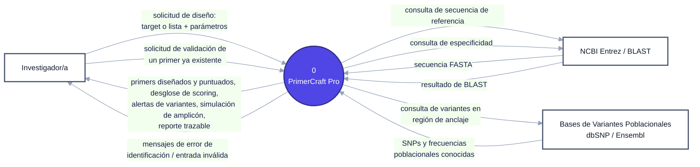

 
 
# Documento de Especificación de Arquitectura — PrimerCraft Pro
 
 
**Ingeniería de Software 2026 · FIUNER · TP3**
 
 
| | |
|---|---|
| **Proyecto** | PrimerCraft Pro |
| **Integrantes** | Sara Barbará, Emilia Vergara, Matías Ríos |
| **Versión** | 1.2 (2026-10-24) |
| **Base** | [SRS](../requirements/srs.md) (TP1) · [Escenarios de calidad](../requirements/quality-scenarios/quality-scenarios.md) (TP2) · [Diagrama de contexto](contexto_inicial.md) |
 
 
## Índice
 
 
1. [Introducción](#1-introducción)
2. [Restricciones](#2-restricciones)
3. [Contexto](#3-contexto)
4. [Drivers arquitectónicos](#4-drivers-arquitectónicos)
5. [Estrategia de solución](#5-estrategia-de-solución)
6. [Vista de contenedores](#6-vista-de-contenedores)
7. [Vista de componentes](#7-vista-de-componentes)
8. [Historias de usuario sobre las vistas](#8-historias-de-usuario-sobre-las-vistas)
9. [Decisiones de arquitectura](#9-decisiones-de-arquitectura)
10. [Trazabilidad y riesgos](#10-trazabilidad-y-riesgos)
11. [Glosario y bibliografía](#11-glosario-y-bibliografía)
---
 
 
## 1. Introducción
 
 
### 1.1 Propósito
 
Este documento explica cómo está armado PrimerCraft Pro por dentro, por qué lo armamos así y cómo cada decisión se conecta con los requerimientos (TP1) y los escenarios de calidad (TP2). El proyecto y el alcance no cambian.
 
**La idea que guía todo el documento.** NCBI BLAST, el servicio que usamos para verificar la especificidad de los primers, limita la cantidad de consultas y puede rechazar pedidos durante horas. Cuando eso pasa, el sistema no puede perder los candidatos que ya calculó ni pedirle a la persona que empiece de nuevo (escenario `EC-05`). Toda la arquitectura se deriva de ese problema:
 
1. **El problema** (sección 4): qué escenarios de calidad obligan a darle una forma determinada al sistema.
2. **Los mecanismos** (sección 5.1): qué hay que hacer para resolverlo (guardar el trabajo, reintentar solo, mostrar lo que ya está listo).
3. **La organización general** (sección 5.2): una cadena de etapas separadas, para que la espera de BLAST no frene al resto, y una interfaz web que conversa con el sistema.
4. **La organización de cada pieza por dentro** (sección 5.3).
5. **Cómo se cumple el escenario y qué cuesta** (sección 5.4).
### 1.2 Alcance
 
Se trabajan los dos procesos elegidos en el TP1 (SRS §4):
 
- **Proceso 1 · Preparar target y secuencia de referencia** (CU-01, CU-04).
- **Proceso 2 · Generar y caracterizar candidatos de primers** (CU-02, CU-03, CU-05).
Historias de usuario implementadas: HU-01.1, HU-02.1, HU-02.2, HU-03.1, HU-03.2, HU-03.3, HU-04 y HU-05.
 
Los procesos 3 (variantes poblacionales) y 4 (puntaje y trazabilidad) quedan como **caja negra**: aparecen como un único contenedor sin detalle interno, y la [sección 6.3](#63-cómo-se-sumarían-los-procesos-3-y-4) explica dónde se conectarían.
 
 
### 1.3 Relación con el DFD del TP1
 
El DFD dice **qué** hace y con quien interactua el sistema; la arquitectura decide **cómo se reparte ese trabajo en piezas**. No tiene por qué haber una pieza por proceso.
 
| Elemento del DFD Nivel 1 | En esta arquitectura |
|---|---|
| P1 · Gestor de preparación de datos | Contenedor "Preparación de datos". La validación de formato que el DFD incluye en P1 se hace antes, en la "Aplicación web" y la "API" |
| P2 · Gestor de diseño de candidatos | **Dos contenedores:** "Diseño de candidatos" (cálculo) y "Verificación de especificidad" (consulta a BLAST). Ver 1.4 |
| P3 y P4 | Contenedor "Variantes y puntaje", caja negra (fuera de esta iteración) |
| D1 · Corridas de diseño | Contenedor "Base de datos de corridas" |
| NCBI Entrez / BLAST | Sistema externo (no es un contenedor: no lo construimos nosotros) |
 
 
### 1.4 ¿Por qué P2 se reparte en dos contenedores?
 
En el TP2, el artefacto del escenario `EC-05` era "la verificación de especificidad del Gestor de Diseño de Candidatos (P2)". En esta arquitectura la verificación pasa a ser un contenedor propio, justamente para cumplir ese escenario:
 
1. **Si BLAST rechaza, el diseño sigue funcionando.** El cálculo de candidatos es local y rápido; la verificación de especificidad depende de un servicio externo con cuota diaria. Si estuvieran juntos, una espera de BLAST frenaría el cálculo de todas las corridas. Separados, solo espera la verificación, que agrega un dato más a cada par de primers.
2. **Mientras se espera, la persona ya ve los resultados termodinámicos.** Los candidatos con su Tm, %GC, ΔG y amplicón ya están calculados y guardados, y se muestran con la especificidad "pendiente".
3. **Un reintento repite solo la consulta a BLAST**, no todo el cálculo.
**¿Y si un candidato no es específico?** En esta iteración no hay rediseño automático: la especificidad es un dato más del candidato, que la persona revisa para elegir (postcondición de CU-05). Quien decidirá "este candidato no sirve, hay que diseñar otro" es el **Proceso 4** (SRS §4: P4 "orquesta el ciclo de reintentos"), que está fuera de esta iteración.
 
Cuando P4 exista, el recorrido será este:
 
1. El par se diseña, se caracteriza y se le agrega la especificidad, aunque sea baja. No vuelve hacia atrás.
2. Sigue la cadena hasta llegar a P4.
3. Si P4 decide que hace falta otro diseño, **abre una corrida nueva** que entra por el comienzo de la cadena con más información: las posiciones a evitar en la secuencia para lograr un par de primers más específicos.
4. Al final, la persona ve todos los pares posibles, incluidos los de baja especificidad, y elige el que quiere.
Así se respeta la regla de tuberías y filtros de no tener retornos hacia etapas anteriores (ver 5.2).
 
 
### 1.5 Contenedor y componente
 
- Un **contenedor** es algo que se ejecuta por separado (una aplicación, una base de datos, una cola de mensajes) y se comunica con otros por red.
- Un **componente** es una parte *dentro* de un contenedor: vive en el mismo programa y se comunica con los demás componentes mediante llamadas internas.
> **Tecnologías propuestas:** TypeScript y React en la web, Node.js y Fastify en la API, Python en las etapas de cálculo, NATS JetStream para las tuberías y PostgreSQL para la base de datos.
 
 
---
 
 
## 2. Restricciones
 
| Restricción | Qué implica para la arquitectura |
|---|---|
| Somos tres personas y tenemos un cuatrimestre | Pocas piezas que operar; descartamos microservicios |
| Las bibliotecas de cálculo bioinformático están en Python (Biopython, primer3-py) | Python para el cálculo; TypeScript para la web y la API (`DA-07`) |
| No hay presupuesto | Todo con software libre, en una sola máquina |
| NCBI BLAST público limita el uso a 100 corridas cada 24 h (SRS RF-06) | Las consultas se espacian y se postergan cuando se llega al límite |
| En el MVP la especificidad se simula localmente; BLAST real es una etapa posterior (SRS §2.6) | Tiene que poder pasarse de la simulación a BLAST sin rehacer el sistema |
| Datos biológicos públicos, sin datos personales (SRS §2.8) | No hay cuentas ni inicio de sesión |
| Ciclo de vida iterativo e incremental: P3 y P4 vienen después | Poder sumarlos sin modificar lo que ya funciona |
 
 
---
 
 
## 3. Contexto
 
Es el diagrama de contexto (DFD Nivel 0) del TP1, sin cambios: los mismos actores y sistemas externos. El original está en [`contexto_inicial.md`](contexto_inicial.md#nivel-0).
 

 
 
---
 
 
## 4. Drivers arquitectónicos
 
Un **driver** es un escenario de calidad que **no se puede cumplir agregando código en un solo lugar**: obliga a cambiar la forma del sistema, por ejemplo agregando un programa aparte, una cola de mensajes o una división en partes.
 
**Cómo lo decidimos.** Para cada escenario nos preguntamos: si el sistema fuera lo más simple posible (una página web, un programa servidor y una base de datos), ¿alcanzaría con agregar código en una sola parte para cumplirlo? Si la respuesta es sí, no es driver.
 
 
### 4.1 Escenarios del TP2
 
Cada escenario del TP2 tiene un identificador `EC-xx`. La columna "Atributo (libro)" aplica la Tabla 1 de la consigna, que traduce la subcaracterística de ISO/IEC 25010 al atributo del libro de Bass, Clements y Kazman, cuyas tácticas usamos en la sección 5.
 
| ID | Escenario (TP2) | Subcaracterística ISO 25010 | Atributo (libro) | Medida de respuesta | ¿Driver? |
|---|---|---|---|---|---|
| `EC-01` | NCBI no devuelve la anotación del gen | Pertinencia funcional | Sin correspondencia: es un requerimiento funcional (RF-10) | 0 herramientas externas y 0 pasos manuales | No |
| `EC-02` | Identificador o secuencia con formato inválido | Protección frente a errores del usuario | Usabilidad | 0 consultas a NCBI; 100 % de los demás campos conservados; corrección en < 10 s | No |
| `EC-03` | Incorporar un nuevo proveedor genómico | Modificabilidad | Modificabilidad | < 15 h/persona; 0 líneas modificadas en el motor de diseño; 0 regresiones | **Sí (secundario)** |
| `EC-04` | NCBI cambia el formato de su respuesta | Interoperabilidad | Interoperabilidad | 100 % de respuestas convertidas; 0 corridas interrumpidas | No |
| `EC-05` | BLAST rechaza la conexión por cuota o timeout | Tolerancia a fallos | Disponibilidad | 0 % de candidatos perdidos; 100 % reintentados sin que la persona vuelva a cargar la corrida | **Sí (principal)** |
 
 
### 4.2 ¿Por qué `EC-05` es el driver principal?
 
Imaginemos la versión más simple del sistema: una página web, un programa servidor y una base de datos. Cuando la persona aprieta "Diseñar", el servidor calcula los candidatos, consulta a BLAST y recién ahí devuelve todo junto.
 
Ahora supongamos que BLAST contesta "superaste el límite de consultas, volvé más tarde". Con esa versión:
 
- BLAST va a **rechazar pedidos muy seguido**. BLAST permite 100 consultas cada 24 horas: que rechace pedidos es parte de su funcionamiento normal, no un error raro.
- **Se pierde lo calculado.** La página no puede quedarse esperando horas: el pedido se corta y los candidatos ya calculados se pierden con él. Si los guardáramos en la memoria del servidor, también se perderían si el programa se reinicia. Esto incumple "0 % de candidatos perdidos".
- **No podemos pedirle a la persona que vuelva a empezar.** El escenario exige que el reintento sea automático.
Para cumplir el escenario hacen falta tres cosas que la versión simple no tiene:
 
1. Que el trabajo se haga **en segundo plano**, en programas aparte, y no mientras la página espera.
2. Un lugar que **guarde los candidatos** hasta que BLAST responda y que no se borre si algo se reinicia (una cola de mensajes guardada en disco).
3. Que la consulta a BLAST esté **separada del cálculo**, para que su espera no frene el diseño (ver 1.4).
Agregar programas aparte y una cola cambia la forma del sistema, no solo su código. Por eso `EC-05` es un driver, y de él sale el estilo elegido (sección 5.2).
 
 
### 4.3 ¿Por qué `EC-03` es driver secundario?
 
Para incorporar un proveedor genómico nuevo (por ejemplo, Ensembl) sin tocar el motor de diseño (0 líneas modificadas), el código que se comunica con los servicios externos tiene que estar **separado del código que calcula**, con una interfaz fija en el medio. La consigna (§3.3) cuenta como driver lo que condiciona "la división en contenedores **o componentes**": este escenario no agrega programas nuevos, pero sí obliga a dividir por dentro las etapas que usan servicios externos (patrón hexagonal, sección 5.3). Es secundario porque no define la forma general del sistema.
 
 
### 4.4 ¿Por qué los demás no son drivers?
 
- **`EC-01`** es un requerimiento funcional (RF-10): se resuelve con una función de localización del gen dentro de "Preparación de datos".
- **`EC-02`** se resuelve validando los datos antes de enviarlos, en la aplicación web y en la API, piezas que existen de todas formas porque la persona necesita una interfaz (ver 5.2).
- **`EC-04`** se resuelve dentro del conector con NCBI, leyendo solo los campos que necesita e ignorando los demás. Aprovecha la separación que exige `EC-03`, pero no la causa.
 
Con los drivers definidos, la sección 5 muestra cómo se resuelven.
 
 
---