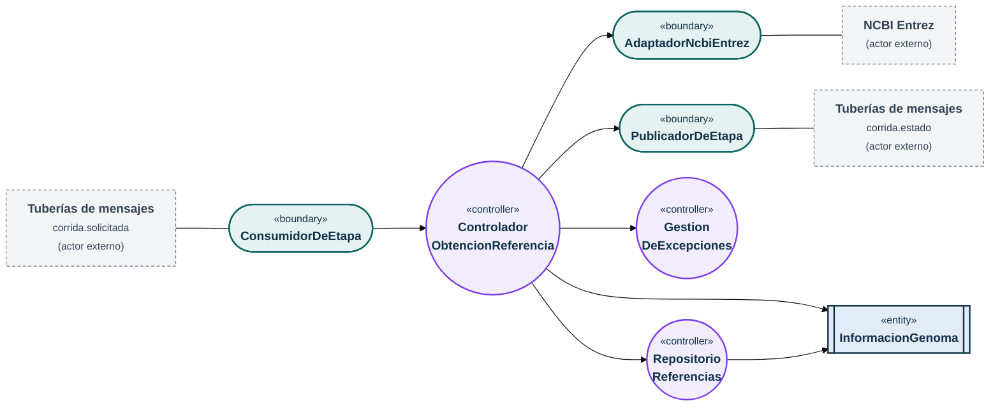
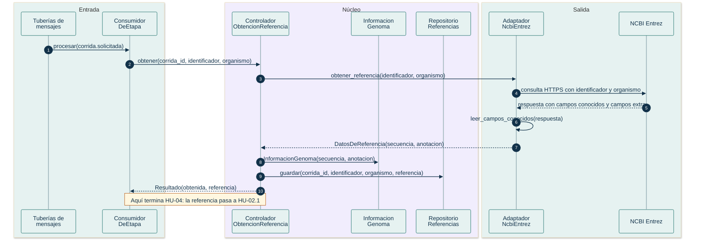
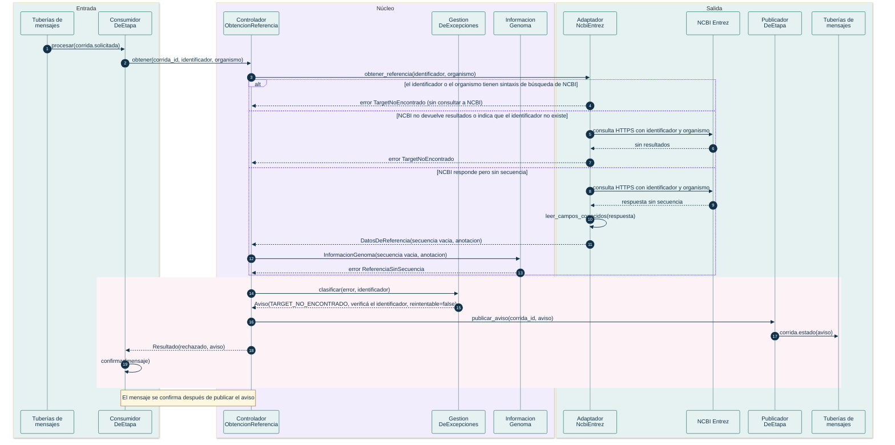
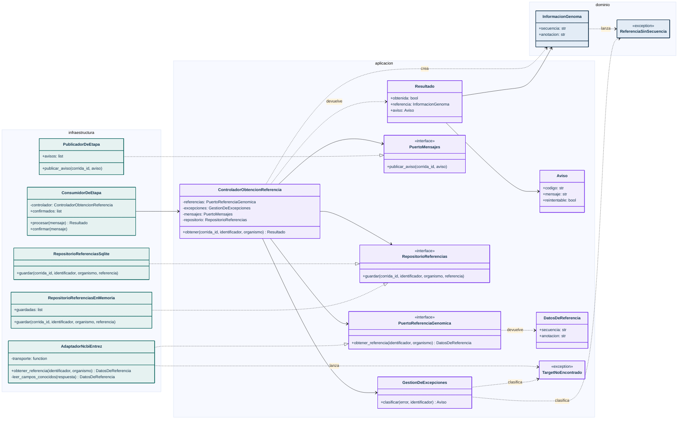
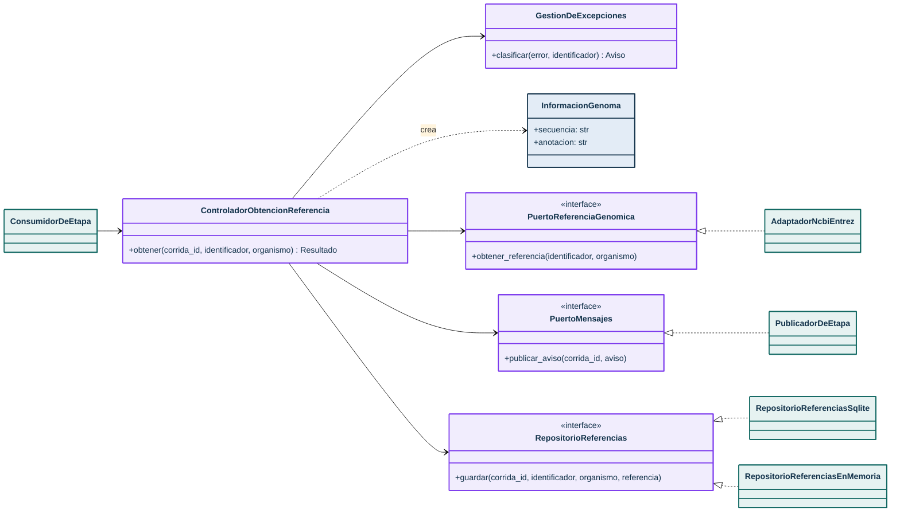

# Diseño detallado — PrimerCraft Pro

**Ingeniería de Software 2026 · FIUNER · TP4 (Parte A)**

| | |
|---|---|
| **Proyecto** | PrimerCraft Pro |
| **Integrantes** | Sara Barbará, Emilia Vergara, Matías Ríos |
| **HU diseñada** | `HU-04` Obtener la secuencia de referencia del target |
| **Base** | [SRS](../requirements/srs.md) (TP1) · [Escenarios de calidad](../requirements/quality-scenarios/quality-scenarios.md) (TP2) · [Arquitectura](../architecture/arquitectura.md) (TP3) |
| **Estado** | Partes A, B y C completas: diseño, implementación y pruebas de `HU-04` |

## Índice

1. [Introducción](#1-introducción)
2. [Relación con la arquitectura](#2-relación-con-la-arquitectura)
3. [Diseño de la HU](#3-diseño-de-la-hu)
4. [Modelo de clases](#4-modelo-de-clases)
5. [Justificación del diseño](#5-justificación-del-diseño)
6. [Implementación](#6-implementación)
7. [Pruebas](#7-pruebas)
8. [Trazabilidad](#8-trazabilidad)
9. [Glosario y bibliografía](#9-glosario-y-bibliografía)

---

## 1. Introducción

### 1.1 Propósito

Este documento baja la arquitectura del TP3 a un diseño detallado para una historia de usuario (HU): analiza la HU en sus tres dimensiones (funcionalidad, estructura y calidad), y deriva de ese análisis un diagrama de robustez y diagramas de secuencia, que se hacen antes de programar. Es la base de la implementación (Parte B). Con el código funcionando se obtiene el modelo de clases, se lo valida contra lo diseñado y se arma la trazabilidad; con eso y la complejidad ciclomática se diseñan las pruebas unitarias (Parte C). Si al implementar o al probar el diseño resultaba incompleto, se corrigieron los diagramas (ver 4.2).

### 1.2 Elección de la HU

Se diseña **`HU-04` — Obtener la secuencia de referencia del target** (deriva de `CU-04`):

**Por qué esta HU.** Cumple las tres condiciones de la consigna:

| Condición | Cómo se cumple |
|---|---|
| Asociada a un escenario de calidad | `EC-04` (NCBI cambia el formato de su respuesta) y `EC-03` (incorporar un proveedor genómico): ambos tienen como elemento C4 el Adaptador NCBI Entrez y los puertos de Preparación de datos |
| Atraviesa la estructura | Recorre el Consumidor de etapa, Obtención de referencia, Gestión de excepciones, el Puerto de referencia genómica, el Adaptador NCBI Entrez y el Publicador de etapa, y termina en NCBI Entrez (TP3, sección 9) |
| Una decisión de arquitectura la afecta | `DA-05` (hexagonal en las etapas con servicios externos) y `DA-03` (clasificación de errores), que citan sus componentes |

Además, es relevante para el proyecto por lo siguiente:

- **Es la puerta de entrada de todos los flujos.** Tanto el diseño de primers (`CU-01`) como la validación de un primer existente (`CU-03`) incluyen `CU-04` (`<<include>>`). Si esta HU falla o está mal diseñada, no existe ningún flujo posterior.
- **Es el punto del sistema más expuesto a un tercero que no controlamos.** NCBI cambia sus esquemas sin aviso (riesgo que `EC-04` formaliza) y puede no tener el identificador pedido. Es donde el diseño tiene que ser más defensivo.
- **Es donde el patrón hexagonal tiene que demostrar su valor.** `EC-03` promete incorporar otro proveedor (Ensembl, dbSNP) sin tocar el motor de diseño. Diseñar esta HU obliga a decidir, con clases concretas, qué sabe el núcleo y qué sabe el adaptador.
- **Tiene un camino de rechazo con una causa clara.** El rechazo (identificador inexistente) ejercita la clasificación de errores definitivos y pasajeros de `DA-03`, y no es un simple alta de campos.

### 1.3 Fuera del alcance de esta HU

Se documenta para no perderlo:

| Fuera de la HU | Dónde está | Por qué queda afuera |
|---|---|---|
| Rechazo por incompatibilidad entre identificador y organismo (`CU-04`, E2) | Gestión de excepciones lo clasifica como definitivo (TP3) | Ningún criterio de `HU-04` lo pide. El diseño lo admite: es otro error definitivo del mismo camino de rechazo |
| «NCBI no disponible»: error pasajero con reintentos | `DA-03` | Ningún criterio de `HU-04` lo pide. Sería un tercer camino de la misma etapa |
| Localización del gen (coordenadas y hebra) | `HU-02.1` | Es otra HU: `HU-04` termina cuando la referencia fue obtenida |
| Validación del formato del identificador y del organismo | Servidor de corridas (`EC-02`, TP3 sección 5.2) | `HU-04` parte de datos ya validados («Given que los datos de entrada fueron validados»). Por seguridad, el adaptador igualmente rechaza la sintaxis de búsqueda de NCBI (ver 3.4) |

### 1.4 Siglas

| Sigla | Significado |
|---|---|
| `CP-xx` | Caso de prueba |
| GRASP | Patrones generales para asignar responsabilidades (*General Responsibility Assignment Software Patterns*) |
| FASTA | Formato de texto para secuencias biológicas |
| IUPAC | Código de nucleótidos, con símbolos para bases ambiguas |
| NCBI | Centro Nacional de Información Biotecnológica (EE. UU.) |
| NATS | Sistema de mensajería que implementa las tuberías (TP3) |
| SQLite | Base de datos liviana en un archivo, usada como persistencia local de la demostración |
| C4 | Modelo de documentación de arquitectura en cuatro niveles |
| TP1 a TP4 | Trabajos prácticos de la materia: TP1 (requerimientos y modelo de dominio), TP2 (escenarios de calidad y UX), TP3 (arquitectura) y TP4 (este diseño detallado) |
| SRS | Especificación de requerimientos de software (TP1) |
| FIUNER | Facultad de Ingeniería de la Universidad Nacional de Entre Ríos |
| UML | Lenguaje unificado de modelado |
| API, HTTPS, JSON, HTML | Interfaz de programación de aplicaciones; protocolo seguro de transferencia de hipertexto; formato de texto para intercambiar datos; lenguaje de marcado de las páginas web |
| GC | Contenido de guanina y citosina de una secuencia de ADN |

---

## 2. Relación con la arquitectura

### 2.1 Tabla de coherencia

| Dimensión | Contenido |
|---|---|
| Funcionalidad | `HU-04` deriva de `CU-04` (RF-03 y RF-09). Camino principal: consulta exitosa y obtención de FASTA y anotación. Camino de rechazo: identificador inexistente o sin resultados|
| Estructura | Contenedor **Preparación de datos** (etapa 1). Componentes que atraviesa, de afuera hacia adentro: Consumidor de etapa (adaptador de entrada), Obtención de referencia (núcleo, componente principal), Gestión de excepciones (núcleo), Puerto de referencia genómica y Puerto de mensajes (puertos), Adaptador NCBI Entrez y Publicador de etapa (adaptadores de salida). Además, un Repositorio de referencias (persistencia local, sin componente en el TP3: ver 5.2). Estilo: tuberías y filtros (la etapa es un filtro). Patrón: hexagonal|
| Calidad | `EC-04` (principal para esta HU): interoperabilidad, medida «100 % de respuestas con la secuencia se convierten sin excepciones; 0 corridas interrumpidas». Táctica: *adaptar la interfaz* y *respetar estándares*; el adaptador lee solo los campos que necesita. Decisión: `DA-05`. `EC-03` (secundario): modificabilidad (proveedor reemplazable), «0 líneas modificadas en el motor de diseño». Táctica: *encapsular* y *restringir dependencias* mediante puertos. Decisión: `DA-05`. Clasificación del error: `DA-03` |
| Dominio | Entidad que interviene: `InformacionGenoma`. No intervienen las demás |
| Verificación | `EC-04`: prueba que entrega al adaptador una respuesta con campos de metadatos desconocidos y una cabecera FASTA distinta y verifica que obtiene la referencia sin excepción. `EC-03`: prueba del controlador con un adaptador falso que cumple el puerto, sin tocar el controlador |

### 2.2 Restricciones del estilo y de los patrones que rigen

Son las reglas del TP3 que el diseño tiene que respetar (secciones 5.2 y 5.3):

| Estilo o patrón | Regla | Qué implica para `HU-04` |
|---|---|---|
| Tuberías y filtros | Un filtro no conoce a los demás ni comparte estado | La etapa recibe todo lo que necesita en el mensaje `corrida.solicitada` y no consulta a otra etapa |
| Tuberías y filtros | Ninguna etapa usa la base de datos (`DA-04`) | **Excepción acotada:** la etapa guarda la referencia detrás de `RepositorioReferencias`, como persistencia local de demostración (5.2, decisión 7). No usa la base de datos de corridas |
| Tuberías y filtros | Los errores salen por `corrida.estado` | El rechazo se informa publicando un aviso, no devolviendo un error a una etapa anterior |
| Hexagonal | Ninguna flecha sale del núcleo hacia un conector concreto | El controlador y la gestión de excepciones apuntan solo a puertos; solo el adaptador conoce NCBI |
| Broker | La etapa confirma el mensaje de entrada **después** de publicar el de salida | En el rechazo, el mensaje se confirma después de publicar el aviso |

---

## 3. Diseño de la HU

### 3.1 Enunciado y criterios de aceptación

> **Como** investigador/a, **quiero** que el sistema consulte automáticamente NCBI Entrez utilizando el identificador NCBI y el organismo ingresados, **para** obtener la secuencia FASTA y la anotación de referencia necesarias para continuar con el diseño de primers.


Criterios de aceptación, tal como quedaron en el SRS (TP1):

```gherkin
Escenario: Consulta exitosa a NCBI Entrez
  Given que los datos de entrada fueron validados correctamente
  When el sistema consulta NCBI Entrez utilizando el identificador NCBI y el organismo ingresados
  Then el sistema obtiene la secuencia FASTA y la anotación correspondientes al target

Escenario: Identificador inexistente o sin resultados
  Given que el sistema realiza la consulta a NCBI Entrez con los datos ingresados
  When la API de NCBI no devuelve ningún resultado o indica que el identificador es inexistente
  Then el sistema notifica al investigador/a informando el error de que no se encontró el target y le solicita que verifique el identificador ingresado
```

El primer escenario es el **criterio 1** y el segundo, el **criterio 2** (el camino de rechazo).

### 3.2 Entidades del modelo de dominio que intervienen

Modelo de dominio del TP1 ([`modelo-dominio-inicial.md`](../architecture/modelo-dominio-inicial.md)). Se marcan los sustantivos de la HU: *identificador NCBI*, *organismo*, *secuencia FASTA*, *anotación*, *target*, *datos de entrada*.

| Entidad del modelo (TP1) | ¿Interviene? | Detalle |
|---|---|---|
| `InformacionGenoma` | **Sí** | Es lo que la HU produce: la secuencia FASTA y la anotación de referencia. La HU la **crea** y la guarda |
| `Corrida` (y sus tipos `CorridaDeDiseno` y `CorridaDeVerificacion`) | No | El identificador, el organismo y el identificador de la corrida llegan **como datos del mensaje** `corrida.solicitada`. La etapa no carga la corrida ni la modifica: solo el Servidor de corridas accede al estado (`DA-04`). La HU es idéntica para los dos tipos de corrida |
| `ParametrosDeCorrida` | No | Los parámetros (Tm, %GC, longitud) los usa el diseño de candidatos, no la obtención de la referencia |
| `ParDePrimers` y `CandidatoPrimer` | No | Todavía no existen: se generan después, en Diseño de candidatos |
| `Investigador` | No | Es quien inicia la corrida y ve el aviso, pero no interactúa con esta HU: se dispara sola al terminar `CU-01` |

### 3.3 Análisis tridimensional

| Dimensión | Elemento | Detalle |
|---|---|---|
| Funcionalidad | Criterio de aceptación 1 | Consultar NCBI Entrez con el identificador y el organismo, y obtener la secuencia FASTA y la anotación |
| Funcionalidad | Criterio de aceptación 2 | Si NCBI no devuelve resultados o indica que el identificador no existe, informar que no se encontró el target y pedir que se verifique el identificador |
| Estructura | Adaptadores | El consumidor de la tubería `corrida.solicitada`, el adaptador hacia NCBI Entrez y el publicador de avisos hacia `corrida.estado` |
| Estructura | Núcleo | Un controlador de la obtención de referencia y la gestión de excepciones que clasifica el error, más la interfaz del repositorio donde se guarda la referencia |
| Estructura | Dominio | `InformacionGenoma`, que sabe cuándo es válida (tiene secuencia) |
| Calidad | `EC-04` | NCBI agrega campos o cambia la cabecera del FASTA: la secuencia se obtiene igual, y se ignoran los campos desconocidos |
| Calidad | `EC-03` | El núcleo conoce un puerto, no a NCBI: otro proveedor es otro adaptador |
| Calidad | `DA-03` | «No encontrado» es un error **definitivo**: se informa y no se reintenta. Nunca se informa «inexistente» por una caída de NCBI |

Hay atributos de calidad que condicionan decisiones de diseño: `EC-04` hace que el adaptador, y no el núcleo, traduzca la respuesta de NCBI; `EC-03` hace que el controlador reciba el adaptador por el constructor y dependa de una interfaz.

### 3.4 Diagrama de robustez

Leyenda: borde punteado gris = actor externo; rectángulo redondeado verde azulado = *boundary*; círculo violeta = *controller*; rectángulo con barras azul = *entity*. Una línea sin flecha une un actor externo con su frontera. La tubería de mensajes aparece dos veces para no cruzar el diagrama (`corrida.solicitada` a la izquierda y `corrida.estado` a la derecha): es el mismo actor.



La única entidad sale de la tabla de 3.2 (entidades que intervienen). Se verifican las reglas de conexión: los actores externos solo tocan fronteras; las fronteras de entrada solo tocan al controlador; ninguna frontera accede a la entidad; el controlador usa fronteras hacia sistemas externos (el adaptador y el publicador), a la gestión de excepciones y a la entidad. El repositorio es un controlador (guarda y recupera la entidad), por eso `co → rep` y `rep → ig` están permitidas; la base de datos no se dibuja porque el repositorio la oculta detrás de su interfaz. En el diagrama no hay flecha prohibida.

**Elementos y componentes del TP3.**

| Elemento | Componente del TP3 | Capa del patrón hexagonal |
|---|---|---|
| `ConsumidorDeEtapa` | Consumidor de etapa | Adaptador de entrada |
| `ControladorObtencionReferencia` | Obtención de referencia | Núcleo |
| `GestionDeExcepciones` | Gestión de excepciones | Núcleo |
| `InformacionGenoma` | Obtención de referencia (las entidades viven en el núcleo y no son un componente aparte) | Núcleo |
| `AdaptadorNcbiEntrez` | Adaptador NCBI Entrez | Adaptador de salida |
| `PublicadorDeEtapa` | Publicador de etapa | Adaptador de salida |
| `RepositorioReferencias` | Sin componente en el TP3: persistencia local de la etapa, excepción a `DA-04` (ver 5.2) | Núcleo (interfaz); sus implementaciones, adaptador de salida |

**Dónde vive cada regla de negocio.**

| Regla | Dónde vive | Por qué |
|---|---|---|
| Una referencia solo es válida si trae una secuencia nucleotídica no vacía con alfabeto IUPAC; la anotación es opcional | **Entidad** `InformacionGenoma` | Experto en información, y no se puede saltear: no puede existir una referencia sin secuencia. La anotación es opcional porque `EC-01` prevé genomas sin tabla de anotación |
| «NCBI no devolvió resultados» significa «target no encontrado» | **Adaptador** `AdaptadorNcbiEntrez`, que la traduce a un error del puerto | Solo el adaptador conoce cómo NCBI expresa «no hay resultados». No decide qué hacer con el error, solo informa el hecho con un tipo definido por el puerto |
| «No encontrado» es un error definitivo: se informa, no se reintenta | **Controlador de apoyo** `GestionDeExcepciones` | `DA-03` concentra la clasificación en un solo lugar para que no se mezclen definitivos y pasajeros |
| El aviso debe decir que no se encontró el target y pedir que se verifique el identificador | **`GestionDeExcepciones`** | Es quien arma el aviso a partir de la clasificación. La pantalla solo lo muestra |
| Ignorar los campos desconocidos de la respuesta (`EC-04`) | **Adaptador** | No es regla del negocio sino conocimiento del formato de NCBI: va donde está ese conocimiento |
| Un identificador u organismo con sintaxis de búsqueda de NCBI (por ejemplo `BRCA1 OR TP53`) se trata como target no encontrado, sin consultar | **Adaptador** | Solo el adaptador conoce la sintaxis de búsqueda de NCBI. No decide qué hacer: informa el hecho con el error que define el puerto |
| Confirmar el mensaje de entrada después de publicar el aviso | **`ConsumidorDeEtapa`** | Regla del broker (`DA-02`): el consumidor es el único que conoce la tubería |
| Se guarda la referencia solo si se obtuvo; un rechazo no guarda nada | **Controlador** `ControladorObtencionReferencia`, que decide cuándo; `RepositorioReferencias` guarda | El controlador conoce el resultado; el repositorio solo persiste lo que le entregan, sin decidir |

Ninguna regla vive en una frontera que decida: el adaptador traduce y el consumidor confirma, pero ninguno decide qué es válido para el negocio.

### 3.5 Diagramas de secuencia

Se dibuja un diagrama por camino, con los mismos participantes que la robustez, más los dos actores externos. Los participantes se agrupan en tres cajas (entrada, núcleo y salida) con los colores de la robustez, y los mensajes están numerados. En la secuencia B la tubería de mensajes aparece dos veces, como en la robustez: a la izquierda recibe `corrida.solicitada` y a la derecha recibe el aviso en `corrida.estado`. La primera secuencia cubre el criterio 1 y la segunda el criterio 2. Cada participante es una clase y cada mensaje, una operación con el mismo nombre en el código (ver 6.4); la consulta a NCBI y la publicación en la tubería son mensajes con los actores externos y se escriben como frases.

**Secuencia A: consulta exitosa (criterio 1)**



Aquí termina `HU-04`. La referencia pasa a Localización de gen (`HU-02.1`), que publica `referencia.localizada` y recién entonces el consumidor confirma el mensaje de entrada (`DA-02`).

**Secuencia B: identificador inexistente o sin resultados (criterio 2)**



El mensaje de entrada se confirma **después** de publicar el aviso. Así, si la etapa se reinicia antes de publicarlo, el broker vuelve a entregar el mensaje y el aviso no se pierde. `confirmar` es una operación del consumidor: con las tuberías simuladas registra el mensaje confirmado y, con NATS, enviaría la confirmación al broker.

**Camino que no se dibuja.** Si el error no es ninguno de los dos de `HU-04` (por ejemplo, una caída de la red), `GestionDeExcepciones.clasificar` lo vuelve a lanzar en lugar de armar un aviso. Ese es el camino de un error pasajero (`DA-03`), que queda fuera de esta HU (1.3 y 6.5); lo ejercita `CP-11` por ser una rama del código.

**Asignación de responsabilidades.**

| Responsabilidad | Quién | Criterio GRASP |
|---|---|---|
| Recibir `corrida.solicitada` y confirmarla después de publicar | `ConsumidorDeEtapa` | Bajo acoplamiento: es el único que conoce la tubería; el núcleo no |
| Coordinar la obtención y decidir el orden de los pasos | `ControladorObtencionReferencia` | Controlador: orquesta sin hacer el trabajo del dominio ni conocer NCBI |
| Pedir la secuencia y la anotación a NCBI, leer solo los campos conocidos y rechazar sin consultar la sintaxis de búsqueda | `AdaptadorNcbiEntrez` | Experto en información: es el único que conoce el formato y la sintaxis de NCBI. Resuelve `EC-04` |
| Crear la `InformacionGenoma` | `ControladorObtencionReferencia` | Creador: recibe del adaptador la secuencia y la anotación con que se inicializa |
| Validar que la referencia tenga secuencia | `InformacionGenoma` | Experto en información: conoce su secuencia |
| Clasificar el error y armar el aviso | `GestionDeExcepciones` | Alta cohesión: es el único lugar que distingue errores definitivos de pasajeros (`DA-03`) |
| Publicar el aviso en `corrida.estado` | `PublicadorDeEtapa` | Bajo acoplamiento: el núcleo lo ve como un puerto de mensajes |
| Guardar la referencia obtenida | `RepositorioReferencias` (el controlador decide cuándo) | Bajo acoplamiento: el controlador depende de una interfaz. Alta cohesión: solo persiste |
| Obtener la referencia sin conocer el proveedor | Puerto de referencia genómica | Bajo acoplamiento: el controlador depende de una interfaz (`EC-03`) |

**Validación de las secuencias.** Cada diagrama entra en una pantalla; hay un camino de error; ninguna frontera decide (el adaptador solo traduce hechos de NCBI, el consumidor solo confirma); cada mensaje tiene un responsable. La táctica de `EC-04` se ve en `leer_campos_conocidos`; la de `EC-03`, en que el controlador solo llama a `obtener_referencia`, definido por el puerto.

---

## 4. Modelo de clases

### 4.1 Diagrama de clases obtenido del código

Se obtuvo del código implementado (Parte B, carpeta `src/`) en dos pasos:

1. Con la herramienta **pyreverse** (de `pylint`): `pyreverse -o mmd -p hu04 src/dominio src/aplicacion src/infraestructura`. Reconoce las 16 clases, sus operaciones y atributos públicos y las relaciones de herencia y de realización de interfaces.
2. Se completó lo que la herramienta no infiere: las operaciones y atributos privados (`-leer_campos_conocidos`, `-controlador`, `-transporte`...) y las dependencias de uso, creación y lanzamiento de errores. Una comparación automática (un script que lee este diagrama y el código) comprueba que clases, estereotipos, operaciones, parámetros, atributos y realizaciones coinciden con el código: 16 clases en el diagrama y 16 en el código, sin diferencias.



Las clases se agrupan por capa (`infraestructura`, `aplicacion` y `dominio`), de izquierda a derecha como van las dependencias, y llevan el color de su capa, el mismo de la robustez: verde azulado para infraestructura (las fronteras), violeta para la aplicación (los controladores y los puertos) y azul para el dominio (la entidad).

Notas sobre el diagrama:

- `InformacionGenoma` expone `secuencia` y `anotacion` de solo lectura porque el repositorio las guarda; su comportamiento sigue siendo el constructor, que **valida** que haya secuencia con alfabeto IUPAC y lanza `ReferenciaSinSecuencia`.
- `ConsumidorDeEtapa` y `PublicadorDeEtapa` no declaran los detalles del cliente NATS: es detalle de infraestructura.
- `confirmados`, `avisos` y `guardadas` son el estado de las clases simuladas: guardan en memoria lo que se les pidió, para que las pruebas lo verifiquen. Con NATS y una base real no existirían.
- `Aviso` sigue el formato del mensaje `corrida.estado` definido en el TP3 (sección 5.2): `codigo` y `mensaje` son los mismos campos, y un error definitivo es `reintentable = false`. Del mismo modo, `corrida_id`, `identificador` y `organismo` corresponden a `idCorrida`, `identificadorNcbi` y `organismo` del mensaje; el consumidor traduce entre el JSON y estas clases.
- `PuertoMensajes` tiene solo `publicar_aviso`. `publicar_referencia` aparece cuando se diseñe `HU-02.1`, que es quien publica la región.
- `-transporte` es la función que consigue la respuesta cruda de NCBI: `consultar_entrez` (real) o `consultar_grabacion` (respuestas grabadas). Son funciones y no clases, por eso no se dibujan.
- Para que el diagrama se lea, no se dibujan las líneas de uso de tipos que ya se ven en las firmas y atributos (por ejemplo, que `ConsumidorDeEtapa.procesar` devuelve un `Resultado` o que `GestionDeExcepciones.clasificar` devuelve un `Aviso`). Sí se dibujan las que las firmas no muestran: quién crea la entidad, quién lanza cada error y quién lo clasifica.

### 4.2 Validación contra la robustez y las secuencias

El diagrama obtenido del código se contrastó con el diagrama de robustez (3.4) y con las secuencias (3.5). Las clases, operaciones y atributos del diagrama coinciden con el código; las diferencias estaban en las **secuencias**, que el grupo dibujó antes de programar:

| Diferencia encontrada | Qué estaba mal | Qué se hizo |
|---|---|---|
| El código `AdaptadorNcbiEntrez.obtener_referencia` rechaza, sin consultar a NCBI, un identificador u organismo con sintaxis de búsqueda (por ejemplo `BRCA1 OR TP53`). La secuencia B no lo mostraba | El diseño: la regla estaba en la tabla de robustez (3.4) pero faltaba en la secuencia | Se actualizó la secuencia B con una rama `alt` para ese caso (`CP-20`, `CP-21`) |
| La secuencia B dibujaba `confirmar(mensaje)` como un mensaje del consumidor a la tubería. En el código es una operación de `ConsumidorDeEtapa` | El diseño: la operación estaba puesta en un actor externo, que no es una clase | Se cambió a una llamada del consumidor a sí mismo, `Con->>Con: confirmar(mensaje)`. Con NATS esa operación enviaría la confirmación al broker |
| `GestionDeExcepciones.clasificar` vuelve a lanzar los errores que no son de `HU-04`, y el controlador solo los deja pasar. Ninguna secuencia lo muestra | El código tiene un camino que el diseño no dibuja | Se dejó sin dibujar y se documentó en 3.5: es el error pasajero de `DA-03`, fuera de esta HU (1.3 y 6.5). Lo ejercita `CP-11` |
| `AdaptadorNcbiEntrez` recibe el transporte (`consultar_entrez` o `consultar_grabacion`) por el constructor, y el diagrama de clases no lo tenía | El diseño: faltaba un atributo | Se agregó `-transporte` a la clase. Las funciones de transporte no se dibujan porque no son clases |
| pyreverse no muestra las operaciones ni los atributos privados, ni las dependencias de creación y de lanzamiento de errores | Una limitación de la herramienta, no del código | Se completaron a mano mirando el código y los verifica la comparación automática |

Con esas correcciones, todo lo que aparece en el diagrama se usa en alguna secuencia y viceversa, salvo los datos (`DatosDeReferencia`, `Aviso`, `Resultado`), las excepciones y las implementaciones simuladas, que se explican en las notas de 4.1. Las entidades no son anémicas: `InformacionGenoma` valida en su constructor que haya una secuencia con alfabeto IUPAC. No se encontraron diferencias con el TP3 ni con el modelo de dominio del TP1 distintas de las ya documentadas en 5.3 y 8.2.

### 4.3 Resumen para la presentación

Versión reducida del diagrama de 4.1: deja solo las clases que explican el diseño y las operaciones clave. Se lee de izquierda a derecha: la entrada (`ConsumidorDeEtapa`), el controlador, las interfaces que el controlador conoce (los puertos y el repositorio) y, a la derecha, las clases concretas que las implementan. Los colores son los de siempre: verde azulado para infraestructura, violeta para la aplicación y azul para el dominio.



Cómo se lee:

- **El controlador solo conoce interfaces.** `ControladorObtencionReferencia` depende de `PuertoReferenciaGenomica`, `PuertoMensajes` y `RepositorioReferencias`, nunca de NCBI, de NATS ni de SQLite (`DA-05`, `EC-03`).
- **Cambiar una implementación no toca el controlador.** Para otro proveedor genómico se escribe otra clase a la derecha de `PuertoReferenciaGenomica`; para otra base, otra clase a la derecha de `RepositorioReferencias`.
- **La regla de negocio está en el dominio.** El controlador crea `InformacionGenoma`, que valida que haya una secuencia con alfabeto IUPAC; `GestionDeExcepciones` decide si un error es definitivo o pasajero (`DA-03`).
- Quedan fuera de este resumen `Resultado`, `Aviso`, `DatosDeReferencia` y las dos excepciones, que están en 4.1.

---

## 5. Justificación del diseño

### 5.1 Responsabilidad de cada clase principal

| Clase | Responsabilidad | Criterio GRASP |
|---|---|---|
| `ControladorObtencionReferencia` | Coordinar: pide la referencia por el puerto, la convierte en entidad y, si algo falla, delega la clasificación y publica el aviso | Controlador; Creador |
| `InformacionGenoma` | Garantizar que no exista una referencia sin secuencia válida | Experto en información |
| `AdaptadorNcbiEntrez` | Hablar con NCBI y entregar solo la secuencia y la anotación, ignorando el resto | Experto en información; Alta cohesión |
| `GestionDeExcepciones` | Decidir si un error es definitivo o pasajero y redactar el aviso | Alta cohesión |
| `ConsumidorDeEtapa` / `PublicadorDeEtapa` | Aislar al núcleo del broker | Bajo acoplamiento |
| `RepositorioReferencias` | Guardar la referencia obtenida detrás de una interfaz, sin decidir nada | Bajo acoplamiento; Alta cohesión |

### 5.2 Decisiones de diseño

1. **El adaptador devuelve `DatosDeReferencia` y el controlador crea la entidad.** Se pensó que el adaptador creara `InformacionGenoma` directamente (tiene los datos). Se descartó porque una frontera no debe acceder a una entidad (regla de robustez: *boundary → entity* está prohibido), y porque el adaptador se acoplaría al dominio. Con `DatosDeReferencia`, el adaptador entrega datos neutros y el dominio decide si son válidos.
2. **La regla «sin secuencia no hay referencia» vive en la entidad, no en el adaptador ni en el controlador.** Si viviera en el adaptador, un segundo proveedor (`EC-03`) tendría que repetirla. En la entidad, cualquier proveedor pasa por la misma regla.
3. **Tres interfaces, y solo tres.** `PuertoReferenciaGenomica` existe porque `EC-03` pide intercambiar proveedores y porque permite probar el controlador con un adaptador falso. `PuertoMensajes` existe porque el broker es otro mecanismo de infraestructura que el núcleo no debe conocer. `RepositorioReferencias` existe porque la consigna pide la persistencia detrás de una interfaz y porque permite probar sin tocar el disco. No se crearon interfaces para `GestionDeExcepciones` ni para `InformacionGenoma`: tienen una sola implementación posible y la indirección no compraría nada.
4. **`GestionDeExcepciones` es una clase aparte y no un `if` en el controlador.** Es la pieza que el TP3 define para `DA-03`. Hoy clasifica dos errores, pero a ella se suman «NCBI no disponible» y «no coincide con el organismo» sin engordar al controlador.
5. **El resultado de un rechazo es un valor, no una excepción hacia arriba.** `Resultado(rechazado, aviso)` permite al consumidor decidir confirmar el mensaje sin capturar excepciones: el rechazo definitivo es un resultado esperado del negocio, no una falla del programa.
6. **Sin patrones de diseño formales.** El patrón hexagonal ya es una decisión de arquitectura (`DA-05`). No se agregó ningún otro: la secuencia se resuelve con composición e interfaces simples.
7. **La etapa guarda la referencia: excepción acotada a `DA-04`.** `DA-04` dice que ninguna etapa usa la base y que solo el Servidor de corridas guarda el estado de la corrida. La consigna del TP4 pide implementar la persistencia detrás de una interfaz de repositorio, y esta HU, sola, no tiene un Servidor de corridas que la reciba. Por eso se agrega `RepositorioReferencias`, con una implementación SQLite y otra en memoria, como **persistencia local de demostración**: no es la base de datos de corridas y no guarda el estado de la corrida. En el sistema real esa copia la guarda el Servidor de corridas (Registrador → Servicio → Repositorio) y el repositorio de la etapa se quita cambiando una línea del controlador. El costo es que la etapa deja de ser sin estado y el diseño se aparta de `DA-04` en este punto.

### 5.3 Qué cambió al bajar de la arquitectura al diseño

- Se descubrió que el catálogo de relaciones de Preparación de datos no incluía el mensaje **Obtención de referencia → Puerto de mensajes** para publicar el aviso de error (ver 8.2). Se actualizó el TP3.
- Al implementar y comparar el código con las secuencias, la secuencia B resultó incompleta: faltaba el rechazo por sintaxis de búsqueda y la confirmación del mensaje estaba dibujada en la tubería y no en el consumidor. Se corrigió el diagrama (ver 4.2).
- Las entidades del dominio (`InformacionGenoma`) no figuran como componentes en el TP3; se asignan al núcleo, dentro de Obtención de referencia, sin cambiar la vista.
- Se agregó `RepositorioReferencias`, que el TP3 no prevé en las etapas: es una excepción a `DA-04` y no cambia el TP3 (ver 5.2, decisión 7).

---

## 6. Implementación

### 6.1 Estructura del código

```text
src/
├── dominio/            informacion_genoma.py          InformacionGenoma, ReferenciaSinSecuencia
├── aplicacion/         controlador_obtencion_referencia.py   ControladorObtencionReferencia, Resultado
│                       gestion_de_excepciones.py             GestionDeExcepciones
│                       puertos.py                            PuertoReferenciaGenomica, PuertoMensajes, RepositorioReferencias,
│                                                             DatosDeReferencia, Aviso, TargetNoEncontrado
├── infraestructura/    adaptador_ncbi_entrez.py       AdaptadorNcbiEntrez
│                       publicador_de_etapa.py         PublicadorDeEtapa
│                       consumidor_de_etapa.py         ConsumidorDeEtapa
│                       repositorio_referencias.py     RepositorioReferenciasSqlite, RepositorioReferenciasEnMemoria
├── interfaz/           app.py, presentacion.py, templates/pantalla.html, static/   pantalla (boundary)
└── arranque.py         punto de arranque
tests/                  test_hu04.py (CP-01 a CP-08), test_complementarias.py (CP-09 a CP-24)
```

Lenguaje: Python (`DA-07`: las etapas son Python). Interfaz: FastAPI con una plantilla HTML con el estilo de las maquetas del TP2.

### 6.2 Cómo se ejecuta

Instalación, ejecución de la pantalla y de las pruebas: ver el `README.md` del repositorio.

### 6.3 Cómo se reemplazan la persistencia y los servicios externos

- **Proveedor genómico:** cualquier clase que cumpla `PuertoReferenciaGenomica`. Se elige en `arranque.py`; el controlador no cambia (`EC-03`, `CP-05`).
- **NCBI:** el `AdaptadorNcbiEntrez` recibe un *transporte*: `consultar_entrez` (real) o `consultar_grabacion` (respuestas grabadas, para trabajar sin internet).
- **Broker:** `PublicadorDeEtapa` simula `corrida.estado` guardando los avisos en memoria; NATS se conectaría detrás de `PuertoMensajes`. El `ConsumidorDeEtapa` recibe el JSON de `corrida.solicitada` con el formato del TP3 (sección 5.2) y lo traduce a la llamada al controlador.
- **Persistencia:** `RepositorioReferencias` (interfaz) con `RepositorioReferenciasSqlite` (por defecto, archivo `primercraft.db`) y `RepositorioReferenciasEnMemoria` (pruebas). Se cambia en `arranque.py`; el controlador no cambia. Es la excepción a `DA-04` documentada en la sección 5.2 (decisión 7).

### 6.4 Coherencia entre el código y las secuencias

El código sigue las secuencias de 3.5: cada participante es una clase y cada mensaje, una operación con el mismo nombre.

| Mensaje de las secuencias | Operación en el código |
|---|---|
| `Brk->>Con: procesar(corrida.solicitada)` | `ConsumidorDeEtapa.procesar(mensaje)`: recibe el JSON del TP3 (`idCorrida`, `carga.identificadorNcbi`, `carga.organismo`) |
| `Con->>CO: obtener(corrida_id, identificador, organismo)` | `ControladorObtencionReferencia.obtener`, que devuelve un `Resultado` |
| `CO->>AD: obtener_referencia(identificador, organismo)` | `AdaptadorNcbiEntrez.obtener_referencia`, definida por `PuertoReferenciaGenomica` |
| `AD->>AD: leer_campos_conocidos(respuesta)` | `AdaptadorNcbiEntrez._leer_campos_conocidos` (en Python, el guion bajo marca lo privado) |
| `CO->>IG: InformacionGenoma(secuencia, anotacion)` | Constructor de `InformacionGenoma`, que valida |
| `CO->>REP: guardar(corrida_id, identificador, organismo, referencia)` | `RepositorioReferencias.guardar`, con las implementaciones `RepositorioReferenciasSqlite` y `RepositorioReferenciasEnMemoria` |
| `CO->>GE: clasificar(error, identificador)` | `GestionDeExcepciones.clasificar`, que devuelve un `Aviso` |
| `CO->>PUB: publicar_aviso(corrida_id, aviso)` | `PublicadorDeEtapa.publicar_aviso`, definida por `PuertoMensajes` |
| `Con->>Con: confirmar(mensaje)` | `ConsumidorDeEtapa.confirmar` |

Los datos que viajan en los mensajes (`DatosDeReferencia`, `Aviso(codigo, mensaje, reintentable)`, `Resultado`) tienen los mismos campos en el código y en el diagrama de clases. `Aviso` usa los mismos campos que `carga` de `corrida.estado` en el TP3, y `Resultado` vive en el mismo archivo que el controlador. El estado de las clases simuladas (`ConsumidorDeEtapa.confirmados`, `PublicadorDeEtapa.avisos`, `RepositorioReferenciasEnMemoria.guardadas`) aparece en el diagrama de clases (4.1). Las diferencias que se encontraron al comparar y cómo se resolvieron están en 4.2.

### 6.5 Fuera del alcance de esta implementación

- Rechazo por organismo que no coincide y reintento por «NCBI no disponible» (`DA-03`), según el alcance del slice. Ante una falla de red, la pantalla muestra un aviso genérico y registra el error en la consola del servidor.
- Descarte de mensajes repetidos por `idMensaje` (`DA-02`) y publicación de `referencia.localizada` (`HU-02.1`).
- La pantalla no calcula nada (no hay GC, composición ni mapa de features): `presentacion.py` solo ordena en líneas y bloques lo que devuelve el controlador.
- Una respuesta de NCBI sin la lista de resultados (`idlist`), por ejemplo un JSON de error, se trata como una falla del servicio y no como «sin resultados» (`CP-28`). Llega a la pantalla como el aviso genérico; el reintento (`DA-03`) queda fuera de esta HU.

### 6.6 La pantalla de demostración

La pantalla (`src/interfaz/`) existe para mostrar `HU-04` funcionando en la defensa; no forma parte del diseño de la etapa, por eso no aparece en la robustez ni en las secuencias. En el TP3 la persona usa la Aplicación web, que habla con el Servidor de corridas, y es el Consumidor de etapa quien recibe `corrida.solicitada` y llama al controlador. Para la demostración, la pantalla llama **directo al controlador** (`obtener`), el mismo método al que llega el consumidor. Por eso:

- La demostración recorre el controlador, el adaptador, la gestión de excepciones y el repositorio, pero no el consumidor ni la confirmación del mensaje; esas piezas se prueban con `CP-12`, `CP-13` y `CP-14`.
- La pantalla conoce solo al controlador y recibe un `Resultado`, de donde lee los atributos de solo lectura `secuencia` y `anotacion` de la referencia para mostrarlos. No los modifica, no calcula nada y no decide nada; es una lectura para mostrar, y no una regla de negocio.
- El único dato que la pantalla genera es el identificador de la corrida (`idCorrida`), que en el sistema real llega en el mensaje.

---

## 7. Pruebas

Pruebas automatizadas con **pytest** (`tests/`). Se ejecutan con `pytest` desde la raíz y no usan internet ni la interfaz gráfica. Resultado de la última ejecución: **28 casos de prueba (30 ejecuciones de pytest, porque `CP-26` se ejecuta una vez por variante), todos pasan**, con **100 %** de cobertura de sentencias y de ramas (sin la interfaz ni el arranque).

**Técnicas.** *Caja negra*: se parte del criterio de aceptación o del escenario de calidad, sin mirar el código, con casos de **partición en clases de equivalencia** (una clase de entradas válidas y otra de entradas inválidas) o de **valores límite** (por ejemplo, la secuencia vacía). *Caja blanca*: se parte del código y de su **complejidad ciclomática** (7.3): una prueba por cada camino independiente de las operaciones de la HU. *Integración*: varias clases reales juntas. Las pruebas usan la estructura preparar, ejecutar y verificar; no usan el formato Given-When-Then.

**Orígenes.** Criterio 1 y criterio 2 de `HU-04` (SRS); `EC-04` (NCBI cambia el formato de su respuesta); `EC-03` (cambiar de proveedor genómico); persistencia (Parte B); código de las operaciones de la HU.

### 7.1 Tabla de casos de prueba

| ID | Técnica | Origen | Datos de entrada | Resultado esperado | Prueba |
|---|---|---|---|---|---|
| `CP-01` | Caja negra (partición: referencia válida) | Criterio 1 | Adaptador falso que devuelve secuencia `ACGT` y anotación `FEATURES` | `Resultado` con `obtenida = True`, la referencia con esa secuencia y anotación, y ningún aviso publicado | `test_hu04.py::test_cp01_obtiene_la_referencia_cuando_ncbi_la_devuelve` |
| `CP-02` | Caja negra (partición: identificador inexistente) | Criterio 2 | Adaptador falso que lanza `TargetNoEncontrado("NM_X")` | `obtenida = False`, sin referencia; aviso con `codigo = TARGET_NO_ENCONTRADO`, `reintentable = False` y un mensaje que nombra `NM_X` y pide verificar el identificador; un aviso publicado | `test_hu04.py::test_cp02_rechaza_y_avisa_si_el_identificador_no_existe` |
| `CP-03` | Caja blanca (rama: la entidad rechaza) y valor límite (secuencia vacía) | Criterio 2 | Adaptador falso que devuelve secuencia vacía | El mismo rechazo de `CP-02`: sin referencia, aviso definitivo, un aviso publicado | `test_hu04.py::test_cp03_rechaza_si_la_respuesta_no_trae_secuencia` |
| `CP-04` | Caja negra (partición: respuesta con campos desconocidos) | `EC-04` | Respuesta de NCBI con un campo desconocido, una cabecera FASTA distinta y minúsculas en la secuencia | `DatosDeReferencia` sin excepción; secuencia concatenada; anotación que empieza en `FEATURES` y no incluye `ORIGIN` | `test_hu04.py::test_cp04_el_adaptador_ignora_campos_y_cabecera_desconocidos` |
| `CP-05` | Caja negra (partición: otro proveedor) | `EC-03` | Un segundo proveedor (clase que cumple el puerto) con secuencia `TTGGCCAA` | El mismo controlador, sin modificarse, obtiene la referencia | `test_hu04.py::test_cp05_el_controlador_funciona_con_otro_proveedor_sin_modificarse` |
| `CP-06` | Caja blanca (rama: éxito) | Persistencia | Adaptador falso con secuencia válida; repositorio en memoria | El repositorio recibe una referencia con `c1`, `NM_1` y `Homo sapiens` | `test_hu04.py::test_cp06_guarda_la_referencia_cuando_se_obtiene` |
| `CP-07` | Caja blanca (rama: rechazo) | Persistencia | Adaptador falso que lanza `TargetNoEncontrado` | El repositorio no recibe nada | `test_hu04.py::test_cp07_no_guarda_nada_si_se_rechaza` |
| `CP-08` | Integración | Persistencia | Controlador con repositorio SQLite en un archivo temporal; la referencia tiene secuencia `ACGT` y anotación `FEATURES`; se consulta la base abierta aparte | La fila `c1`, `NM_1`, `Homo sapiens`, `ACGT`, `FEATURES` está en la tabla `referencias` | `test_hu04.py::test_cp08_sqlite_conserva_la_referencia_al_reabrir_la_base` |
| `CP-09` | Caja blanca (limpieza de la secuencia) | Código de `InformacionGenoma` | `"acg t\nn"` | Secuencia `ACGTN` (sin espacios, en mayúsculas) | `test_complementarias.py::test_cp09_la_entidad_normaliza_la_secuencia` |
| `CP-10` | Caja blanca (rama: alfabeto inválido) y partición (caracteres fuera de IUPAC) | Código de `InformacionGenoma` | `"ACGT123"` | Lanza `ReferenciaSinSecuencia` | `test_complementarias.py::test_cp10_la_entidad_rechaza_caracteres_fuera_de_iupac` |
| `CP-11` | Caja blanca (rama: error desconocido) | Código de `GestionDeExcepciones` | Un `ValueError` | Se vuelve a lanzar: un error desconocido no se oculta como «no encontrado» | `test_complementarias.py::test_cp11_la_gestion_de_excepciones_no_oculta_errores_desconocidos` |
| `CP-12` | Caja negra (partición: mensaje válido) | Mensaje `corrida.solicitada` (TP3, 5.2) | Mensaje con `idCorrida`, `carga.identificadorNcbi = NM_000518` y `carga.organismo` | El consumidor traduce el JSON y el controlador obtiene la referencia | `test_complementarias.py::test_cp12_el_consumidor_traduce_el_json_y_llama_al_controlador` |
| `CP-13` | Caja blanca (rama: rechazo) | `DA-02` | Mensaje con un identificador que no existe (`NM_999999`) | El aviso se publica primero y el mensaje se confirma después (`eventos == ["aviso publicado", "mensaje confirmado"]`; `confirmados == ["c1"]`) | `test_complementarias.py::test_cp13_el_consumidor_confirma_el_mensaje_despues_de_publicar_el_aviso` |
| `CP-14` | Caja blanca (rama: éxito) | `DA-02` | Mensaje con `NM_000518` | El consumidor no confirma (lo hará la etapa tras publicar `referencia.localizada`, `HU-02.1`) | `test_complementarias.py::test_cp14_el_consumidor_no_confirma_en_el_exito` |
| `CP-15` | Caja blanca (rama: segundo registro) | `EC-04` | FASTA con dos registros (`>uno` ACGT, `>dos` GGGG) | Solo se toma el primero: `ACGT` | `test_complementarias.py::test_cp15_el_adaptador_toma_solo_el_primer_registro_del_fasta` |
| `CP-16` | Caja blanca (camino real) | `EC-04` | `consultar_entrez` con `requests.get` reemplazado por respuestas armadas a mano | Devuelve el FASTA y la anotación pedidos | `test_complementarias.py::test_cp16_consultar_entrez_devuelve_la_secuencia_y_la_anotacion` |
| `CP-17` | Caja blanca (rama: sin resultados) | Criterio 2 | `consultar_entrez` con una búsqueda que devuelve lista de ids vacía | Lanza `TargetNoEncontrado` | `test_complementarias.py::test_cp17_consultar_entrez_sin_resultados_lanza_target_no_encontrado` |
| `CP-18` | Integración | Criterio 1 | Respuestas grabadas de NCBI para `NM_000518` (*Homo sapiens*) | Referencia obtenida con 628 nt | `test_complementarias.py::test_cp18_con_las_respuestas_grabadas_se_obtiene_la_referencia_de_nm_000518` |
| `CP-19` | Integración | Criterio 2 | Registro grabado `NM_SIN_SECUENCIA` (existe pero viene vacío) | Rechazo con `codigo = TARGET_NO_ENCONTRADO` | `test_complementarias.py::test_cp19_un_registro_sin_secuencia_se_rechaza_como_no_encontrado` |
| `CP-20` | Caja blanca (rama: sintaxis inválida) | `EC-04` y criterio 2 | Identificador `BRCA1 OR TP53` (sintaxis de búsqueda de NCBI) | Se trata como target no encontrado (`TargetNoEncontrado`) y **no se consulta a NCBI** | `test_complementarias.py::test_cp20_un_identificador_con_sintaxis_de_busqueda_se_trata_como_no_encontrado` |
| `CP-21` | Caja blanca (rama: sintaxis inválida) | `EC-04` y criterio 2 | Organismo `Homo sapiens[Organism] OR x` | Se trata como target no encontrado | `test_complementarias.py::test_cp21_un_organismo_con_sintaxis_de_busqueda_se_trata_como_no_encontrado` |
| `CP-22` | Caja blanca (limpieza de entrada) | `EC-04` | Identificador `" NM_000518 "` y organismo `" Homo sapiens "` con espacios sobrantes | El transporte recibe `NM_000518` y `Homo sapiens` sin espacios | `test_complementarias.py::test_cp22_el_adaptador_ignora_los_espacios_sobrantes_del_identificador_y_el_organismo` |
| `CP-23` | Caja blanca (rama: ciclo del FASTA sin vueltas) | `EC-04` | Respuesta de NCBI sin los campos `fasta` ni `genbank` (`{}`) | `DatosDeReferencia` con secuencia y anotación vacías, sin excepción (la entidad la rechaza después, como en `CP-03`) | `test_complementarias.py::test_cp23_una_respuesta_sin_fasta_ni_genbank_devuelve_datos_vacios` |
| `CP-24` | Caja blanca (condición: identificador de la grabación con otro organismo) | Código de `consultar_grabacion` | Respuestas grabadas: `NM_000518` con el organismo `Mus musculus` | Lanza `TargetNoEncontrado`: la grabación solo vale para *Homo sapiens* | `test_complementarias.py::test_cp24_las_respuestas_grabadas_no_valen_para_otro_organismo` |
| `CP-25` | Caja blanca (camino real) | `EC-04` | `consultar_entrez` con `requests.get` reemplazado; la búsqueda devuelve dos resultados (`123` y `456`) para `NM_1` y *Mus musculus* | La búsqueda es `NM_1[Accession] AND Mus musculus[Organism]` y las descargas piden solo el primer resultado (`123`) | `test_complementarias.py::test_cp25_consultar_entrez_busca_por_codigo_de_acceso_y_organismo_y_pide_el_primer_resultado` |
| `CP-26` | Caja negra (partición: variantes del formato del FASTA) | `EC-04` | Respuesta con un campo desconocido y FASTA con saltos de línea de Windows, con una línea en blanco al final o con la cabecera vacía (tres variantes de la misma prueba) | Secuencia `ACGTAC` en las tres, sin excepción | `test_complementarias.py::test_cp26_el_adaptador_obtiene_la_secuencia_aunque_cambie_la_forma_del_fasta` |
| `CP-27` | Caja blanca (camino real) | `EC-04` | `consultar_entrez` con `requests.get` reemplazado y `time.sleep` registrado | Espera dos veces, al menos 0,34 s: NCBI admite 3 pedidos por segundo | `test_complementarias.py::test_cp27_consultar_entrez_espera_entre_pedidos_para_respetar_el_limite_de_ncbi` |
| `CP-28` | Caja blanca (rama: respuesta de error de NCBI) | `DA-03` | `consultar_entrez` con `requests.get` reemplazado; la búsqueda contesta `{"esearchresult": {"ERROR": ...}}` y no una lista de resultados | Lanza `RuntimeError` (una falla del servicio) y **no** `TargetNoEncontrado`: nunca se informa «inexistente» por un error de NCBI | `test_complementarias.py::test_cp28_consultar_entrez_no_confunde_un_error_de_ncbi_con_un_target_inexistente` |

### 7.2 Trazabilidad de las pruebas

| Se quiere verificar | Casos |
|---|---|
| Criterio de aceptación 1 (consulta exitosa) | `CP-01`, `CP-06`, `CP-12`, `CP-18` |
| Criterio de aceptación 2 (identificador inexistente o sin resultados) | `CP-02`, `CP-03`, `CP-07`, `CP-13`, `CP-17`, `CP-19`, `CP-20`, `CP-21`, `CP-24` |
| `EC-04`: «100 % de respuestas con la secuencia se convierten sin excepciones; 0 corridas interrumpidas» | `CP-04` (la medida), con `CP-15`, `CP-16`, `CP-20`, `CP-21`, `CP-22`, `CP-23`, `CP-25`, `CP-26` y `CP-27` |
| `EC-03`: «0 líneas modificadas en el motor de diseño» | `CP-05` |
| `DA-02` (confirmar después de publicar) | `CP-13`, `CP-14` |
| `DA-03` (clasificación definitiva de los errores) | `CP-02`, `CP-03`, `CP-11`, `CP-28` |

`CP-01` a `CP-08` son los casos previstos al diseñar; `CP-09` a `CP-22` se agregaron al revisar el reporte de cobertura y el código, `CP-23` y `CP-24` al calcular la complejidad ciclomática (7.3), y `CP-25` a `CP-27` al comprobar, rompiendo el código a propósito, que las pruebas detectan los errores (ver `cobertura.md`), y `CP-28` al revisar la implementación (un error de NCBI no es un «target inexistente»). Cada prueba verifica un solo comportamiento y no depende de otra. Ninguna pasa por la interfaz gráfica.

### 7.3 Complejidad ciclomática

La complejidad de una operación es la cantidad de caminos independientes de su código: las decisiones (`if`, ciclos, condiciones combinadas con «y» u «o» y manejadores de excepciones) más uno. Es el criterio de la caja blanca: se escribe una prueba por camino y el reporte de cobertura de ramas confirma que no quedó ninguno sin recorrer. Se calculó solo para las operaciones de `HU-04` que tienen decisiones; las demás (el publicador, los repositorios, los puertos y `confirmar`) tienen complejidad 1 y una sola prueba las recorre. Los valores se calcularon a mano y se confirmaron con la herramienta `radon` (`radon cc -s src/`).

| Operación | Decisiones | Complejidad | Pruebas, una por camino |
|---|---|---|---|
| `ControladorObtencionReferencia.obtener` | 1 (falla la obtención o la validación) | 2 | `CP-01` (éxito) y `CP-02` (rechazo) |
| `GestionDeExcepciones.clasificar` | 1 (error de `HU-04` o desconocido) | 2 | `CP-02` (lo clasifica) y `CP-11` (lo vuelve a lanzar) |
| `InformacionGenoma.__init__` | 2 (sin secuencia, caracteres fuera de IUPAC) | 3 | `CP-03` (vacía), `CP-10` (fuera de IUPAC) y `CP-09` (válida) |
| `AdaptadorNcbiEntrez.obtener_referencia` | 2 (el `si` y el `y` que combina «identificador válido» con «organismo válido») | 3 | `CP-20` (identificador inválido), `CP-21` (organismo inválido) y `CP-22` (ambos válidos) |
| `AdaptadorNcbiEntrez._leer_campos_conocidos` | 7 (ciclo del FASTA, línea de cabecera, segundo registro, ciclo de GenBank, `FEATURES`, `ORIGIN`, línea dentro de `FEATURES`) | 8 | `CP-23` (FASTA sin líneas), `CP-04` (cabecera, secuencia, `FEATURES`, `ORIGIN` y líneas antes y dentro de `FEATURES`) y `CP-15` (segundo registro, GenBank sin líneas) |
| `consultar_entrez` | 3 (respuesta de error sin lista de resultados, búsqueda sin resultados, ciclo de pedidos) | 4 | `CP-28` (respuesta de error), `CP-17` (sin resultados) y `CP-16` (con resultados; `CP-25` y `CP-27` verifican qué pide y cómo espera). El ciclo recorre una tupla fija de dos pedidos, así que su camino sin vueltas no existe |
| `consultar_grabacion` | 3 (`si`, `y` y `sino si`) | 4 | `CP-18` (`NM_000518` en *Homo sapiens*), `CP-24` (`NM_000518` en otro organismo), `CP-19` (`NM_SIN_SECUENCIA`) y `CP-13` (otro identificador) |
| `ConsumidorDeEtapa.procesar` | 1 (rechazo o éxito) | 2 | `CP-13` (rechazo, confirma) y `CP-14` (éxito, no confirma) |

La mayor complejidad es 8 (`_leer_campos_conocidos`), por debajo del umbral de 10 a partir del cual conviene dividir una operación. En esa operación, cada prueba atraviesa varias decisiones a la vez, así que los 8 caminos se recorren con 3 pruebas (`CP-23`, `CP-04` y `CP-15`), y la cobertura de ramas de 100 % confirma que no queda ninguna rama sin recorrer. El cálculo mostró dos caminos sin prueba, que se resolvieron con `CP-23` y `CP-24`.

### 7.4 Cobertura

El reporte completo y su análisis están en [`cobertura.md`](cobertura.md). Resumen: 159 sentencias y 34 ramas, todas cubiertas, sin contar la interfaz ni el arranque. La primera corrida fue de 90 % (el adaptador, 69 %, porque nadie ejecutaba el camino real de NCBI); se resolvió con `CP-15` a `CP-17` y `CP-20` a `CP-22`.

---

## 8. Trazabilidad

Se completa después de implementar (Parte B) y de probar (Parte C), con el código y las pruebas ya hechos.

### 8.1 Trazabilidad de la HU

| HU | Escenario / decisión | Componente C4 | Clases | Archivo | Pruebas |
|---|---|---|---|---|---|
| `HU-04`, criterio 1 | `DA-05` | Obtención de referencia; Puerto de referencia genómica; Adaptador NCBI Entrez | `ControladorObtencionReferencia`, `PuertoReferenciaGenomica`, `AdaptadorNcbiEntrez`, `InformacionGenoma`, `DatosDeReferencia`, `Resultado` | `src/aplicacion/controlador_obtencion_referencia.py`, `src/infraestructura/adaptador_ncbi_entrez.py`, `src/dominio/informacion_genoma.py` | `CP-01`, `CP-09`, `CP-10`, `CP-18` |
| `HU-04`, criterio 2 | `DA-03` | Obtención de referencia; Gestión de excepciones; Puerto de mensajes; Publicador de etapa | `ControladorObtencionReferencia`, `GestionDeExcepciones`, `PuertoMensajes`, `PublicadorDeEtapa`, `TargetNoEncontrado`, `ReferenciaSinSecuencia`, `Aviso` | `src/aplicacion/gestion_de_excepciones.py`, `src/infraestructura/publicador_de_etapa.py` | `CP-02`, `CP-03`, `CP-11`, `CP-19` |
| `HU-04` | `EC-04`, `DA-05` | Adaptador NCBI Entrez | `AdaptadorNcbiEntrez` | `src/infraestructura/adaptador_ncbi_entrez.py` | `CP-04`, `CP-15` a `CP-17`, `CP-20` a `CP-28` |
| `HU-04` | `EC-03`, `DA-05` | Puerto de referencia genómica | `PuertoReferenciaGenomica` | `src/aplicacion/puertos.py` | `CP-05` |
| `HU-04`, criterio 1 (persistencia) | `DA-04` (excepción) | Sin componente en el TP3 | `RepositorioReferencias`, `RepositorioReferenciasSqlite`, `RepositorioReferenciasEnMemoria` | `src/aplicacion/puertos.py`, `src/infraestructura/repositorio_referencias.py` | `CP-06`, `CP-07`, `CP-08` |
| `HU-04` (entrada y confirmación) | `DA-02` | Consumidor de etapa | `ConsumidorDeEtapa` | `src/infraestructura/consumidor_de_etapa.py` | `CP-12`, `CP-13`, `CP-14` |

Toda clase del diagrama con operaciones propias aparece en alguna secuencia (4.2), cada criterio de aceptación llega al menos a un caso de prueba (7.2) y cada camino de las operaciones de la HU tiene su prueba (7.3).

### 8.2 Actualizaciones a documentos anteriores

- **TP3, sección 7.3** ([`arquitectura.md`](../architecture/arquitectura.md#73-preparación-de-datos-etapa-1--patrón-hexagonal)): se agregó la relación «Obtención de referencia → Puerto de mensajes» en el diagrama de componentes y en la tabla de relaciones, porque la etapa publica por ese puerto el aviso del error definitivo. Sin ella, el catálogo no permitía el mensaje que la sección 9 ya describía.
- **TP3, secciones 7.3, 7.4 y 7.5:** la relación «Consumidor de etapa → Tuberías» ahora incluye la confirmación del mensaje después de publicar (`DA-02`), que las secuencias usan.
- **Modelo de dominio del TP1:** sin cambios.

Si al comparar el código con el diseño aparece una diferencia con el TP3 o con el modelo de dominio del TP1 (una relación que falta en el catálogo, una entidad nueva), no es un error del grupo: se documenta y se actualiza el documento anterior, como se hizo arriba.

---

## 9. Glosario y bibliografía

**Glosario.** Los términos del dominio y de la arquitectura (adaptador, puerto, núcleo, tubería, etapa, aviso) siguen las definiciones del [documento de arquitectura](../architecture/arquitectura.md#12-glosario-y-bibliografía). Términos propios de este documento:

| Término | Significado |
|---|---|
| Aviso | Mensaje que una etapa publica en `corrida.estado` para informar un estado o un error, con un `codigo`, un `mensaje` y si es `reintentable`: pasajero (`reintentable = true`) o definitivo (`reintentable = false`) (`DA-03`) |
| `DatosDeReferencia` | Datos neutros (secuencia y anotación) que el adaptador entrega al núcleo; todavía no son una entidad validada |
| Complejidad ciclomática | Cantidad de caminos independientes de una operación: sus decisiones más uno. Indica cuántas pruebas de caja blanca hacen falta (7.3) |
| Error definitivo | Error que no se corrige reintentando; se informa y se pide corregir el dato (por ejemplo, «target no encontrado») |

**Bibliografía.**

- Larman, C. *Applying UML and Patterns*. Prentice Hall. Criterios GRASP.
- Rosenberg, D. y Stephens, K. *Use Case Driven Object Modeling with UML*. Apress, 2007. Diagrama de robustez.
- Valotto, V. *Diseño tridimensional de software*. 2025. Material de la cátedra.
- Documento de arquitectura del TP3 y SRS del TP1.
